

         

<h3 align="center"> Universidad Peruana de Ciencias Aplicadas </h3>

<h3 align="center">Carrera de Ingeniería de Software </h3>

<h3 align="center">
    <b>
        1ACC0238 
    </b>    
</h3>

<h3 align="center"> 
    <b>
        Aplicaciones para Dispositivos Móviles
    </b>
</h3>
<h3 align="center"> NRC </h3>

<h3 align="center">  
    <b>
        3690
    </b>
</h3>

<h3 align="center"> 
    <b>
        Informe de Trabajo Final
    </b>
</h3>

<h3 align="center"> Docente</h3>
<h3 align="center"> 
    <b>
        Mayta Guillermo, Jorge Luis 
    </b>
</h3>

<h3 align="center"> Equipo </h3>
<h3 align="center">  
    <b>
        Cryologic System
    </b>
</h3>

<h3 align="center"> Proyecto</h3>
<h3 align="center">  
    <b>
        SafeFlow
    </b>
</h3>

 

<h3 align="center">  
    <b>
        Integrantes
    </b>
</h3>

 
| Code       |      Member |
| :---:      |     :--- |
| U202218531 | Andy Alejandro Mio Mejia |
| U********* | --------- |
| U********* | --------- |
| U********* | --------- |
| U********* | --------- |

<h3 align="center">
    <b>
        Periodo 202620
    </b>
</h3>
<h3 align="center">
    <b>
        Julio 2026
    </b>
</h3>

## Registro de Versiones del Informe

    
| Versión |   Fecha    |                Autor                |                                                  Descripción de modificación                                                   |
|:-------:|:----------:|:-----------------------------------:|:------------------------------------------------------------------------------------------------------------------------------:|
|   AV1   | 12-09-2026 |   Mio Mejia, Andy Alejandro   |                                                   Descripción de la Startup                                                    |
|   AV1   | 12-09-2026 |   Mio Mejia, Andy Alejandro    |                                               Creación de la carpeta de Imagenes                                               |
|   AV1   | 12-09-2026 |   Mio Mejia, Andy Alejandro    |                                             Creacion de Ramas en los Repositorios                                              |                                              |
|   AV1   | 12-09-2026 |   Mio Mejia, Andy Alejandro    |                                                    Source Code Management.                                                     |              

## Project Report Collaboration Insights

A lo largo del desarrollo del trabajo, se ha evidenciado una participación activa, coordinada y progresiva por parte de todos los integrantes del equipo. Cada fase fue abordada de manera estructurada, siguiendo las buenas prácticas de trabajo colaborativo con control de versiones en GitHub, planificación por entregables, y asignación clara de responsabilidades según las competencias de cada integrante.

El uso de repositorios específicos por subcomponente también contribuyó a mantener una mejor trazabilidad del trabajo colaborativo, integrando ramas por entregables y controlando versiones según el avance de cada sprint.

A continuación, se detallan los repositorios utilizados a lo largo del proyecto:

#### Link del Repositorio del Reporte: [Repositorio del Informe](https://github.com/upc-pre-202620-1acc0238-4950-cryologic/safeflow-report.git)
#### Link del Repositorio de la Landing Page:  [Repositorio del Landing]()
#### Link del Repositorio del Frontend:  [Repositorio del Frontend]()
#### Link del Repositorio del Backend:  [Repositorio del Backend]()

A continuación, se detallan los Link de lo Desarrollado:

#### Link de la Landing Page:  [Link de la Landing Page]()
#### Link de la Plataforma Web:  [Link de la App Web]()

   

| Integrante | Tareas Asignadas                                                                                                                                                                                             |
|------------|------------------------------------------------------------------------------------------------------------------------------------------------------------------------------------------------------------------------------------------------------------------------------------------------------------------------------------------------------------------------------------------------------------------------------------------------------------------------------------------------------------------------------------------------------------------------------------------------------------------------------------------------------------------------------------------------------------------------------------------------------------------------------------------------------------------------------------------------------------------------------------------------------------------------------------------------------------------------------------------------------------------------------------|
| Andy Alejandro Mio Mejia | ****************** |
|  ******************  | ******************                                                                                                                                                                                                                                                                                                                                                                                                                                                                                    |
| ****************** | ****************** |
| ******************    | ******************                                                                                                                                                                                                                                   |
| ******************    | ******************                                                                                                       |

El proceso de colaboración en el informe se realizó mediante commits constantes al repositorio de la organización.

## **Github Collaboration Insights**

Los integrantes son:

* Andy Alejandro Mio Mejia   (AndyMio17)
* ******************   (********)
* ****************** (********)
* ****************** (********)
* ****************** (********)

   

### Github Collaboration  Informe

  
        

### Github Collaboration  Landing

  
        

### Github Collaboration  Frontend

  
        

### Github Collaboration  Backend

  
        

# Contenido

## Tabla de Contenidos

[Registro de versiones del informe](#registro-de-versiones-del-informe)

[Project Report Collaboration Insights](#project-report-collaboration-insights)

[Contenido](#contenido)

[Student Outcome](#student-outcome)

[Capítulo I: Presentación](#capitulo-i-introduccion)

- [1.1. Startup Profile](#11-startup-profile)
  - [1.1.1. Descripción de la Startup](#111-descripción-de-la-startup)
  - [1.1.2. Perfiles de integrantes del equipo](#112-perfiles-de-integrantes-del-equipo)
- [1.2. Solution Profile](#12-solution-profile)
  - [1.2.1. Antecedentes y problemática](#121-antecedentes-y-problemática)
  - [1.2.2. Lean UX Process](#122-lean-ux-process)
    - [1.2.2.1. Lean UX Problem Statements](#1221-lean-ux-problem-statements)
    - [1.2.2.2. Lean UX Assumptions](#1222-lean-ux-assumptions)
    - [1.2.2.3. Lean UX Hypothesis Statements](#1223-lean-ux-hypothesis-statements)
    - [1.2.2.4. Lean UX Canvas](#1224-lean-ux-canvas)
- [1.3. Segmentos objetivo](#13-segmentos-objetivo)

[Capítulo II: Requirements Elicitation & Analysis](#capítulo-ii-requirements-elicitation--analysis-1)

- [Contenido](#contenido)
  - [Tabla de Contenidos](#tabla-de-contenidos)
- [Student Outcome](#student-outcome)
    - [1. Integrante 1](#1-integrante-1)
    - [2. Integrante 2](#2-integrante-2)
    - [3. Integrante 3](#3-integrante-3)
    - [4. Integrante 4](#4-integrante-4)
    - [5. Integrante 5](#5-integrante-5)
- [Capítulo I: Presentación](#capítulo-i-presentación)
  - [1.1. Startup Profile](#11-startup-profile)
    - [1.1.1. Descripción de la Startup](#111-descripción-de-la-startup)
    - [1.1.2. Perfiles de integrantes del equipo](#112-perfiles-de-integrantes-del-equipo)
  - [1.2. Solution Profile](#12-solution-profile)
    - [1.2.1. Antecedentes y problemática](#121-antecedentes-y-problemática)
    - [1.2.2. Lean UX Process](#122-lean-ux-process)
      - [1.2.2.1. Lean UX Problem Statements](#1221-lean-ux-problem-statements)
      - [1.2.2.2. Lean UX Assumptions](#1222-lean-ux-assumptions)
      - [1.2.2.3. Lean UX Hypothesis Statements](#1223-lean-ux-hypothesis-statements)
      - [1.2.2.4. Lean UX Canvas](#1224-lean-ux-canvas)
  - [1.3. Segmentos objetivo](#13-segmentos-objetivo)
- [Capítulo II: Requirements Elicitation \& Analysis](#capítulo-ii-requirements-elicitation--analysis)
  - [2.1. Competidores](#21-competidores)
    - [2.1.1. Análisis competitivo](#211-análisis-competitivo)
    - [2.1.2. Estrategias y tácticas frente a competidores](#212-estrategias-y-tácticas-frente-a-competidores)
  - [2.2. Entrevistas](#22-entrevistas)
    - [2.2.1. Diseño de entrevistas](#221-diseño-de-entrevistas)
    - [2.2.2. Registro de entrevistas](#222-registro-de-entrevistas)
    - [2.2.3. Análisis de entrevistas](#223-análisis-de-entrevistas)
  - [2.3. Needfinding](#23-needfinding)
    - [2.3.1. User Personas](#231-user-personas)
    - [2.3.2. User Task Matrix](#232-user-task-matrix)
    - [2.3.3. User Journey Mapping](#233-user-journey-mapping)
    - [2.3.4. Empathy Mapping](#234-empathy-mapping)
    - [2.3.5. Big Picture EventStorming](#235-big-picture-eventstorming)
    - [2.3.6. Ubiquitous Language](#236-ubiquitous-language)
  - [2.4. Requirements specification](#24-requirements-specification)
    - [2.4.1. User Stories](#241-user-stories)
    - [2.4.2. Impact Mapping](#242-impact-mapping)
    - [2.4.3. Product Backlog](#243-product-backlog)
  - [2.5. Strategic-Level Domain-Driven Design](#25-strategic-level-domain-driven-design)
    - [2.5.1. EventStorming](#251-eventstorming)
      - [2.5.1.1. Candidate Context Discovery](#2511-candidate-context-discovery)
      - [2.5.1.2. Domain Message Flows Modeling](#2512-domain-message-flows-modeling)
      - [2.5.1.3. Context Canvases](#2513-context-canvases)
    - [2.5.2. Context Mapping](#252-context-mapping)
    - [2.5.3. Software Architecture](#253-software-architecture)
      - [2.5.3.1. Software Architecture Context Level Diagrams](#2531-software-architecture-context-level-diagrams)
      - [2.5.3.2. Software Architecture Container Level Diagrams](#2532-software-architecture-container-level-diagrams)
      - [2.5.3.3. Software Architecture Deployment Diagrams](#2533-software-architecture-deployment-diagrams)
  - [2.6. Tactical-Level Domain-Driven Design](#26-tactical-level-domain-driven-design)
    - [2.6.1. Bounded Context: iam](#261-bounded-context-iam)
      - [2.6.1.1. Domain Layer](#2611-domain-layer)
      - [2.6.1.2. Interface Layer](#2612-interface-layer)
      - [2.6.1.3. Application Layer](#2613-application-layer)
      - [2.6.1.4. Infrastructure Layer](#2614-infrastructure-layer)
      - [2.6.1.5. Bounded Context Software Architecture Component Level Diagrams](#2615-bounded-context-software-architecture-component-level-diagrams)
      - [2.6.1.6. Bounded Context Software Architecture Code Level Diagrams](#2616-bounded-context-software-architecture-code-level-diagrams)
        - [2.6.1.6.1. Bounded Context Domain Layer Class Diagrams](#26161-bounded-context-domain-layer-class-diagrams)
        - [2.6.1.6.2. Bounded Context Database Design Diagram](#26162-bounded-context-database-design-diagram)
    - [2.6.2. Bounded Context: alerts](#262-bounded-context-alerts)
      - [2.6.2.1. Domain Layer](#2621-domain-layer)
      - [2.6.2.2. Interface Layer](#2622-interface-layer)
      - [2.6.2.3. Application Layer](#2623-application-layer)
      - [2.6.2.4. Infrastructure Layer](#2624-infrastructure-layer)
      - [2.6.2.5. Bounded Context Software Architecture Component Level Diagrams](#2625-bounded-context-software-architecture-component-level-diagrams)
      - [2.6.2.6. Bounded Context Software Architecture Code Level Diagrams](#2626-bounded-context-software-architecture-code-level-diagrams)
        - [2.6.2.6.1. Bounded Context Domain Layer Class Diagrams](#26261-bounded-context-domain-layer-class-diagrams)
        - [2.6.2.6.2. Bounded Context Database Design Diagram](#26262-bounded-context-database-design-diagram)
    - [2.6.3. Bounded Context: analytics](#263-bounded-context-analytics)
      - [2.6.3.1. Domain Layer](#2631-domain-layer)
      - [2.6.3.2. Interface Layer](#2632-interface-layer)
      - [2.6.3.3. Application Layer](#2633-application-layer)
      - [2.6.3.4. Infrastructure Layer](#2634-infrastructure-layer)
      - [2.6.3.5. Bounded Context Software Architecture Component Level Diagrams](#2635-bounded-context-software-architecture-component-level-diagrams)
      - [2.6.3.6. Bounded Context Software Architecture Code Level Diagrams](#2636-bounded-context-software-architecture-code-level-diagrams)
        - [2.6.3.6.1. Bounded Context Domain Layer Class Diagrams](#26361-bounded-context-domain-layer-class-diagrams)
        - [2.6.3.6.2. Bounded Context Database Design Diagram](#26362-bounded-context-database-design-diagram)
    - [2.6.4. Bounded Context: environmental-monitoring](#264-bounded-context-environmental-monitoring)
      - [2.6.4.1. Domain Layer](#2641-domain-layer)
      - [2.6.4.2. Interface Layer](#2642-interface-layer)
      - [2.6.4.3. Application Layer](#2643-application-layer)
      - [2.6.4.4. Infrastructure Layer](#2644-infrastructure-layer)
      - [2.6.4.5. Bounded Context Software Architecture Component Level Diagrams](#2645-bounded-context-software-architecture-component-level-diagrams)
      - [2.6.4.6. Bounded Context Software Architecture Code Level Diagrams](#2646-bounded-context-software-architecture-code-level-diagrams)
        - [2.6.4.6.1. Bounded Context Domain Layer Class Diagrams](#26461-bounded-context-domain-layer-class-diagrams)
        - [2.6.4.6.2. Bounded Context Database Design Diagram](#26462-bounded-context-database-design-diagram)
    - [2.6.5. Bounded Context: inventory](#265-bounded-context-inventory)
      - [2.6.5.1. Domain Layer](#2651-domain-layer)
      - [2.6.5.2. Interface Layer](#2652-interface-layer)
      - [2.6.5.3. Application Layer](#2653-application-layer)
      - [2.6.5.4. Infrastructure Layer](#2654-infrastructure-layer)
      - [2.6.5.5. Bounded Context Software Architecture Component Level Diagrams](#2655-bounded-context-software-architecture-component-level-diagrams)
      - [2.6.5.6. Bounded Context Software Architecture Code Level Diagrams](#2656-bounded-context-software-architecture-code-level-diagrams)
        - [2.6.5.6.1. Bounded Context Domain Layer Class Diagrams](#26561-bounded-context-domain-layer-class-diagrams)
        - [2.6.5.6.2. Bounded Context Database Design Diagram](#26562-bounded-context-database-design-diagram)
    - [2.6.6. Bounded Context: logistics](#266-bounded-context-logistics)
      - [2.6.6.1. Domain Layer](#2661-domain-layer)
      - [2.6.6.2. Interface Layer](#2662-interface-layer)
      - [2.6.6.3. Application Layer](#2663-application-layer)
      - [2.6.6.4. Infrastructure Layer](#2664-infrastructure-layer)
      - [2.6.6.5. Bounded Context Software Architecture Component Level Diagrams](#2665-bounded-context-software-architecture-component-level-diagrams)
      - [2.6.6.6. Bounded Context Software Architecture Code Level Diagrams](#2666-bounded-context-software-architecture-code-level-diagrams)
        - [2.6.6.6.1. Bounded Context Domain Layer Class Diagrams](#26661-bounded-context-domain-layer-class-diagrams)
        - [2.6.6.6.2. Bounded Context Database Design Diagram](#26662-bounded-context-database-design-diagram)
    - [2.6.7. Bounded Context: reporting](#267-bounded-context-reporting)
      - [2.6.7.1. Domain Layer](#2671-domain-layer)
      - [2.6.7.2. Interface Layer](#2672-interface-layer)
      - [2.6.7.3. Application Layer](#2673-application-layer)
      - [2.6.7.4. Infrastructure Layer](#2674-infrastructure-layer)
      - [2.6.7.5. Bounded Context Software Architecture Component Level Diagrams](#2675-bounded-context-software-architecture-component-level-diagrams)
      - [2.6.7.6. Bounded Context Software Architecture Code Level Diagrams](#2676-bounded-context-software-architecture-code-level-diagrams)
        - [2.6.7.6.1. Bounded Context Domain Layer Class Diagrams](#26761-bounded-context-domain-layer-class-diagrams)
        - [2.6.7.6.2. Bounded Context Database Design Diagram](#26762-bounded-context-database-design-diagram)
- [Capítulo III: Solution UI/UX Design](#capítulo-iii-solution-uiux-design)
  - [3.1. Product design](#31-product-design)
    - [3.1.1. Style Guidelines](#311-style-guidelines)
      - [3.1.1.1. General Style Guidelines](#3111-general-style-guidelines)
    - [3.1.2. Information Architecture](#312-information-architecture)
      - [3.1.2.1. Organization Systems](#3121-organization-systems)
      - [3.1.2.2. Labelling Systems](#3122-labelling-systems)
      - [3.1.2.3. SEO Tags and Meta Tags](#3123-seo-tags-and-meta-tags)
      - [3.1.2.4. Searching Systems](#3124-searching-systems)
      - [3.1.2.5. Navigation Systems](#3125-navigation-systems)
    - [3.1.3. Landing Page UI Design](#313-landing-page-ui-design)
      - [3.1.3.1. Wireframe](#3131-wireframe)
      - [3.1.3.2. Mock-up](#3132-mock-up)
    - [3.1.4. Mobile Applications UX/UI Design](#314-mobile-applications-uxui-design)
      - [3.1.4.1. Wireframes](#3141-wireframes)
      - [3.1.4.2. Wireflow Diagrams](#3142-wireflow-diagrams)
      - [3.1.4.3. Mock-ups](#3143-mock-ups)
        - [VISITANTE](#visitante)
        - [OPERADOR](#operador)
        - [SUPERVISOR](#supervisor)
        - [ADMIN](#admin)
        - [Versión de tableta](#versión-de-tableta)
      - [3.1.4.4. User Flow Diagrams](#3144-user-flow-diagrams)
      - [3.1.4.5. Prototyping](#3145-prototyping)

<!--
 
Capítulo III: Solution UI/UX Design 
3.1. Product design 
3.1.1. Style Guidelines 
3.1.1.1. General Style Guidelines 
3.1.2. Information Architecture 
3.1.2.1. Organization Systems 
3.1.2.2. Labelling Systems 
3.1.2.3. SEO Tags and Meta Tags 
3.1.2.4. Searching Systems 
3.1.2.5. Navigation Systems 
3.1.3. Landing Page UI Design 
3.1.3.1. Landing Page Wireframe 
3.1.3.2. Landing Page Mock-up 
3.1.4. Mobile Applications UX/UI Design 
3.1.4.1. Mobile Applications Wireframes
3.1.4.2. Mobile Applications Wireflow Diagrams 
3.1.4.3. Mobile Applications Mock-ups 
3.1.4.4. Mobile Applications User Flow Diagrams 
3.1.4.5. Mobile Applications Prototyping 

Capítulo IV: Product Implementation & Validation 
4. Product Implementation & Validation 
4.1. Software Configuration Management 
4.1.1. Software Development Environment Configuration 
4.1.2. Source Code Management 
4.1.3. Source Code Style Guide & Conventions 
4.1.4. Software Deployment Configuration 
4.2. Landing Page & Mobile Application Implementation 
4.2.1. Sprint n 
4.2.1.1. Sprint Planning n 
4.2.1.2. Aspect Leaders and Collaborators 
4.2.1.3. Sprint Backlog n 
4.2.1.4. Development Evidence for Sprint Review
4.2.1.5. Testing Suite Evidence for Sprint Review 
4.2.1.6. Execution Evidence for Sprint Review 
4.2.1.7. Services Documentation Evidence for Sprint Review 
4.2.1.8. Software Deployment Evidence for Sprint Review
4.2.1.9. Team Collaboration Insights during Sprint
4.3. Validation Interviews 
4.3.1. Diseño de Entrevistas 
4.3.2. Registro de Entrevistas 
4.3.3. Evaluaciones según heurísticas

Conclusiones 
Conclusiones y recomendaciones. 
Video App Validation 
Video About the product 
Video About the team 
Glosario 
Bibliografía 
Anexos
 -->

[Capítulo III: Solution UI/UX Design](#capítulo-iii-solution-uiux-design)

- [3.1. Product Design](#31-product-design)
  - [3.1.1. Style Guidelines](#311-style-guidelines)
    - [3.1.1.1. General Style Guidelines](#3111-general-style-guidelines)
  - [3.1.2. Information Architecture](#312-information-architecture)
    - [3.1.2.1. Organization Systems](#3121-organization-systems)
    - [3.1.2.2. Labelling Systems](#3122-labelling-systems)
    - [3.1.2.3. SEO Tags and Meta Tags](#3123-seo-tags-and-meta-tags)
    - [3.1.2.4. Searching Systems](#3124-searching-systems)
    - [3.1.2.5. Navigation Systems](#3125-navigation-systems)
  - [3.1.3. Landing Page UI Design](#313-landing-page-ui-design)
    - [3.1.3.1. Landing Page Wireframe](#3131-landing-page-wireframe)
    - [3.1.3.2. Landing Page Mock-up](#3132-landing-page-mock-up)
  - [3.1.4. Mobile Applications UX/UI Design](#314-mobile-applications-uxui-design)
    - [3.1.4.1. Mobile Applications Wireframes](#3141-mobile-applications-wireframes)
    - [3.1.4.2. Mobile Applications Wireflow Diagrams](#3142-mobile-applications-wireflow-diagrams)
    - [3.1.4.3. Mobile Applications Mock-ups](#3143-mobile-applications-mock-ups)
    - [3.1.4.4. Mobile Applications User Flow Diagrams](#3144-mobile-applications-user-flow-diagrams)
    - [3.1.4.5. Mobile Applications Prototyping](#3145-mobile-applications-prototyping)

[Capítulo IV: Product Implementation & Validation](#capítulo-iv-product-implementation-validation)

- [4. Product Implementation & Validation](#4-product-implementation-validation)
  - [4.1. Software Configuration Management](#41-software-configuration-management)
    - [4.1.1. Software Development Environment Configuration](#411-software-development-environment-configuration)
    - [4.1.2. Source Code Management](#412-source-code-management)
    - [4.1.3. Source Code Style Guide & Conventions](#413-source-code-style-guide--conventions)
    - [4.1.4. Software Deployment Configuration](#414-software-deployment-configuration)
  - [4.2. Landing Page & Mobile Application Implementation](#42-landing-page--mobile-application-implementation)
    - [4.2.1. Sprint n](#421-sprint-n)
      - [4.2.1.1. Sprint Planning n](#4211-sprint-planning-n)
      - [4.2.1.2. Aspect Leaders and Collaborators](#4212-aspect-leaders-and-collaborators)
      - [4.2.1.3. Sprint Backlog n](#4213-sprint-backlog-n)
      - [4.2.1.4. Development Evidence for Sprint Review](#4214-development-evidence-for-sprint-review)
      - [4.2.1.5. Testing Suite Evidence for Sprint Review](#4215-testing-suite-evidence-for-sprint-review)
      - [4.2.1.6. Execution Evidence for Sprint Review](#4216-execution-evidence-for-sprint-review)
      - [4.2.1.7. Services Documentation Evidence for Sprint Review](#4217-services-documentation-evidence-for-sprint-review)
      - [4.2.1.8. Software Deployment Evidence for Sprint Review](#4218-software-deployment-evidence-for-sprint-review)
      - [4.2.1.9. Team Collaboration Insights during Sprint](#4219-team-collaboration-insights-during-sprint)
  - [4.3. Validation Interviews](#43-validation-interviews)
    - [4.3.1. Diseño de Entrevistas](#431-diseño-de-entrevistas)
    - [4.3.2. Registro de Entrevistas](#432-registro-de-entrevistas)
    - [4.3.3. Evaluaciones según heurísticas](#433-evaluaciones-según-heurísticas)

[Conclusiones y recomendaciones](#conclusiones-y-recomendaciones)

[Video App Validation](#video-app-validation)

[Video About the product](#video-about-the-product)

[Video About the team](#video-about-the-team)

[Glosario](#glosario)

[Bibliografía](#bibliografía)

[Anexos](#anexos)

# Student Outcome

A continuación, cada integrante del equipo detallará su contribución al proyecto en base a los criterios del Student Outcome (Trabajo en equipo, liderazgo, entorno colaborativo y cumplimiento de metas).

### 1. Integrante 1
* **Criterio específico:** [Por completar]
* **Acciones realizadas:** 
  * [Por completar]
* **Conclusiones:** [Por completar]

### 2. Integrante 2
* **Criterio específico:** [Por completar]
* **Acciones realizadas:** 
  * [Por completar]
* **Conclusiones:** [Por completar]

### 3. Integrante 3
* **Criterio específico:** [Por completar]
* **Acciones realizadas:** 
  * [Por completar]
* **Conclusiones:** [Por completar]

### 4. Integrante 4
* **Criterio específico:** [Por completar]
* **Acciones realizadas:** 
  * [Por completar]
* **Conclusiones:** [Por completar]

### 5. Integrante 5
* **Criterio específico:** [Por completar]
* **Acciones realizadas:** 
  * [Por completar]
* **Conclusiones:** [Por completar]

# Capítulo I: Presentación

## 1.1. Startup Profile

### 1.1.1. Descripción de la Startup

### 1.1.2. Perfiles de integrantes del equipo

## 1.2. Solution Profile

### 1.2.1. Antecedentes y problemática

### 1.2.2. Lean UX Process

#### 1.2.2.1. Lean UX Problem Statements

#### 1.2.2.2. Lean UX Assumptions

#### 1.2.2.3. Lean UX Hypothesis Statements

#### 1.2.2.4. Lean UX Canvas

## 1.3. Segmentos objetivo

# Capítulo II: Requirements Elicitation & Analysis

## 2.1. Competidores

### 2.1.1. Análisis competitivo

### 2.1.2. Estrategias y tácticas frente a competidores

## 2.2. Entrevistas

### 2.2.1. Diseño de entrevistas

### 2.2.2. Registro de entrevistas

### 2.2.3. Análisis de entrevistas

## 2.3. Needfinding

### 2.3.1. User Personas

### 2.3.2. User Task Matrix

### 2.3.3. User Journey Mapping

### 2.3.4. Empathy Mapping

### 2.3.5. Big Picture EventStorming

### 2.3.6. Ubiquitous Language

## 2.4. Requirements specification

### 2.4.1. User Stories

### 2.4.2. Impact Mapping 

### 2.4.3. Product Backlog

## 2.5. Strategic-Level Domain-Driven Design

### 2.5.1. EventStorming

#### 2.5.1.1. Candidate Context Discovery

#### 2.5.1.2. Domain Message Flows Modeling

#### 2.5.1.3. Context Canvases

### 2.5.2. Context Mapping

### 2.5.3. Software Architecture

#### 2.5.3.1. Software Architecture Context Level Diagrams

#### 2.5.3.2. Software Architecture Container Level Diagrams

#### 2.5.3.3. Software Architecture Deployment Diagrams

## 2.6. Tactical-Level Domain-Driven Design

### 2.6.1. Bounded Context: iam

#### 2.6.1.1. Domain Layer

#### 2.6.1.2. Interface Layer

#### 2.6.1.3. Application Layer

#### 2.6.1.4. Infrastructure Layer

#### 2.6.1.5. Bounded Context Software Architecture Component Level Diagrams

#### 2.6.1.6. Bounded Context Software Architecture Code Level Diagrams

##### 2.6.1.6.1. Bounded Context Domain Layer Class Diagrams

##### 2.6.1.6.2. Bounded Context Database Design Diagram

### 2.6.2. Bounded Context: alerts

#### 2.6.2.1. Domain Layer

#### 2.6.2.2. Interface Layer

#### 2.6.2.3. Application Layer

#### 2.6.2.4. Infrastructure Layer

#### 2.6.2.5. Bounded Context Software Architecture Component Level Diagrams

#### 2.6.2.6. Bounded Context Software Architecture Code Level Diagrams

##### 2.6.2.6.1. Bounded Context Domain Layer Class Diagrams

##### 2.6.2.6.2. Bounded Context Database Design Diagram

### 2.6.3. Bounded Context: analytics

#### 2.6.3.1. Domain Layer

#### 2.6.3.2. Interface Layer

#### 2.6.3.3. Application Layer

#### 2.6.3.4. Infrastructure Layer

#### 2.6.3.5. Bounded Context Software Architecture Component Level Diagrams

#### 2.6.3.6. Bounded Context Software Architecture Code Level Diagrams

##### 2.6.3.6.1. Bounded Context Domain Layer Class Diagrams

##### 2.6.3.6.2. Bounded Context Database Design Diagram

### 2.6.4. Bounded Context: environmental-monitoring

#### 2.6.4.1. Domain Layer

#### 2.6.4.2. Interface Layer

#### 2.6.4.3. Application Layer

#### 2.6.4.4. Infrastructure Layer

#### 2.6.4.5. Bounded Context Software Architecture Component Level Diagrams

#### 2.6.4.6. Bounded Context Software Architecture Code Level Diagrams

##### 2.6.4.6.1. Bounded Context Domain Layer Class Diagrams

##### 2.6.4.6.2. Bounded Context Database Design Diagram

### 2.6.5. Bounded Context: inventory

#### 2.6.5.1. Domain Layer

#### 2.6.5.2. Interface Layer

#### 2.6.5.3. Application Layer

#### 2.6.5.4. Infrastructure Layer

#### 2.6.5.5. Bounded Context Software Architecture Component Level Diagrams

#### 2.6.5.6. Bounded Context Software Architecture Code Level Diagrams

##### 2.6.5.6.1. Bounded Context Domain Layer Class Diagrams

##### 2.6.5.6.2. Bounded Context Database Design Diagram

### 2.6.6. Bounded Context: logistics

#### 2.6.6.1. Domain Layer

#### 2.6.6.2. Interface Layer

#### 2.6.6.3. Application Layer

#### 2.6.6.4. Infrastructure Layer

#### 2.6.6.5. Bounded Context Software Architecture Component Level Diagrams

#### 2.6.6.6. Bounded Context Software Architecture Code Level Diagrams

##### 2.6.6.6.1. Bounded Context Domain Layer Class Diagrams

##### 2.6.6.6.2. Bounded Context Database Design Diagram

### 2.6.7. Bounded Context: reporting

#### 2.6.7.1. Domain Layer

#### 2.6.7.2. Interface Layer

#### 2.6.7.3. Application Layer

#### 2.6.7.4. Infrastructure Layer

#### 2.6.7.5. Bounded Context Software Architecture Component Level Diagrams

#### 2.6.7.6. Bounded Context Software Architecture Code Level Diagrams

##### 2.6.7.6.1. Bounded Context Domain Layer Class Diagrams

##### 2.6.7.6.2. Bounded Context Database Design Diagram

# Capítulo III: Solution UI/UX Design

Este capítulo documenta cómo SafeFlow traduce el dominio de la cadena de frío y las historias de usuario del Capítulo II en una interfaz móvil concreta. Primero se fijan las guías de estilo (marca, tipografía, color, espaciado, iconografía, tono y componentes), después se define la arquitectura de información (cómo se organiza, rotula, busca y recorre el contenido) y, por último, se presentan los wireframes, wireflows, mock-ups, flujos de usuario y el prototipo de la aplicación móvil Android. Todo el diseño visual vive en un único archivo de Figma ([SafeFlow en Figma](https://www.figma.com/design/ebf6YJVRmfKTHq2EDicpix/Safeflow)), que es la fuente de verdad de la que se derivan tanto las figuras de este capítulo como los componentes reutilizables de Jetpack Compose del módulo `core/ui`.

## 3.1. Product design

El diseño de producto de SafeFlow describe una aplicación Android para celular y tableta que permite a tres roles (OPERADOR, SUPERVISOR y ADMIN) supervisar la temperatura de productos farmacéuticos y alimenticios, gestionar inventario, atender alertas y validar despachos. El producto se concibe como una herramienta operativa: quien la usa está en un almacén o en tránsito, con poco tiempo y con el costo de una decisión equivocada medido en producto perdido o en riesgo sanitario. Por ello el diseño prioriza la lectura inmediata del estado térmico, la reducción de pasos en las tareas frecuentes y la claridad en los mensajes de error.

Las decisiones de diseño se apoyan en tres criterios. Primero, una sola aplicación con navegación inferior adaptada al rol, de modo que cada usuario ve únicamente lo que su responsabilidad le permite. Segundo, un sistema visual minimalista (blanco, grises y acentos verdes) con colores semánticos de advertencia y criticidad reservados para el estado térmico. Tercero, un diseño reutilizable: las pantallas se construyen con instancias de un conjunto de 13 componentes genéricos `SafeFlow*`, el mismo que se implementa en Android. La aplicación emuladora de sensores es un producto aparte y no se trata en este capítulo.

### 3.1.1. Style Guidelines

Las guías de estilo constituyen el repositorio común del equipo para el diseño: reúnen las decisiones de marca, las fuentes, los tokens de color, las medidas y los componentes, de modo que diseño y código hablen el mismo lenguaje. Como la entrega se limita a la aplicación móvil Android, se documentan las guías generales que aplican a todo el producto; las guías específicas de web quedan fuera de alcance porque no existe una experiencia web.

#### 3.1.1.1. General Style Guidelines

Las guías generales se definieron en el archivo de diseño `safeflow_system_design` de Figma, adaptando como referencia las pautas de Material Design 3 para Android (iconografía, objetivos táctiles y estructura de la navegación inferior) y reemplazando su paleta por una propia. El producto se implementa únicamente en modo claro: no se usan colores dinámicos ni se define una paleta oscura, porque un tema adicional introduciría combinaciones de contraste no validadas para estados críticos.

**Branding.** El producto se llama **SafeFlow**. Su logotipo combina un símbolo de copo de nieve estilizado en verde (alusión directa al frío y a la protección del producto) con el nombre en tipografía Display en negrita, como se aprecia en las pantallas de acceso. La frase de apoyo (tagline) que acompaña a la marca en la pantalla de inicio de sesión es *«Supervisa la cadena de frío de tus productos.»*. El estilo general es minimalista: fondos blancos y gris muy claro, texto en tonos casi negros, y el verde como único acento de marca y de acción.

**Tipografía.** Se usa la familia **Inter**, incluida como recurso local de la aplicación (pesos Regular 400, Medium 500, SemiBold 600 y Bold 700, licencia SIL OFL), por su legibilidad en tamaños pequeños y su buen comportamiento con cifras, esenciales para leer temperaturas como «5.1 °C». La escala tiene ocho estilos, que se muestran en la Figura 46 y se resumen en la Tabla 81.

<strong>Figura 46.</strong> <em>Escala tipográfica de SafeFlow</em>

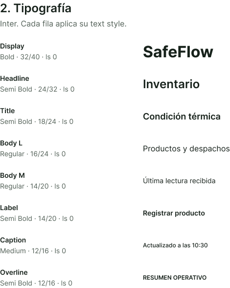

<strong><em>Nota.</em></strong> Captura de la página de sistema de diseño de Figma (safeflow_system_design). Cada fila indica peso, tamaño e interlineado del estilo y un ejemplo con texto real del producto.

<strong>Tabla 81.</strong> <em>Estilos tipográficos y su uso</em>

| Estilo | Peso | Tamaño / interlineado (sp) | Uso en la aplicación |
|---|---|---|---|
| Display | Bold 700 | 32/40 | Nombre de marca en pantallas de acceso |
| Headline | SemiBold 600 | 24/32 | Título de contenido de pantalla («Productos registrados») |
| Title | SemiBold 600 | 18/24 | Título de tarjeta («Vacuna A», «Condición térmica») |
| Body L | Regular 400 | 16/24 | Texto de lectura y valores en campos |
| Body M | Regular 400 | 14/20 | Detalle secundario («Última lectura recibida») |
| Label | SemiBold 600 | 14/20 | Etiquetas de campos y botones |
| Caption | Medium 500 | 12/16 | Metadatos («Actualizado a las 10:30») |
| Overline | SemiBold 600 | 12/16 | Rótulos de sección en mayúsculas («RESUMEN OPERATIVO») |

<strong><em>Nota.</em></strong> Valores definidos en el sistema de diseño y replicados en el tema de la aplicación Android.

La Tabla 81 muestra que la jerarquía se construye con pocos pesos y tamaños, lo que mantiene la coherencia entre pantallas y facilita que el estado y las cifras térmicas se lean primero.

**Colores.** La paleta se organiza en tokens semánticos (superficie, texto, primario, borde, advertencia, crítico e icono), de modo que ninguna pantalla usa valores hexadecimales sueltos. El verde primario `#15803D` expresa acción y estado normal; el ámbar `#B45309` expresa advertencia y el rojo `#B91C1C` criticidad, cada uno con un contenedor tenue para fondos de avisos. La Figura 47 presenta las muestras y la Tabla 82 lista los valores.

<strong>Figura 47.</strong> <em>Tokens de color semánticos de SafeFlow</em>

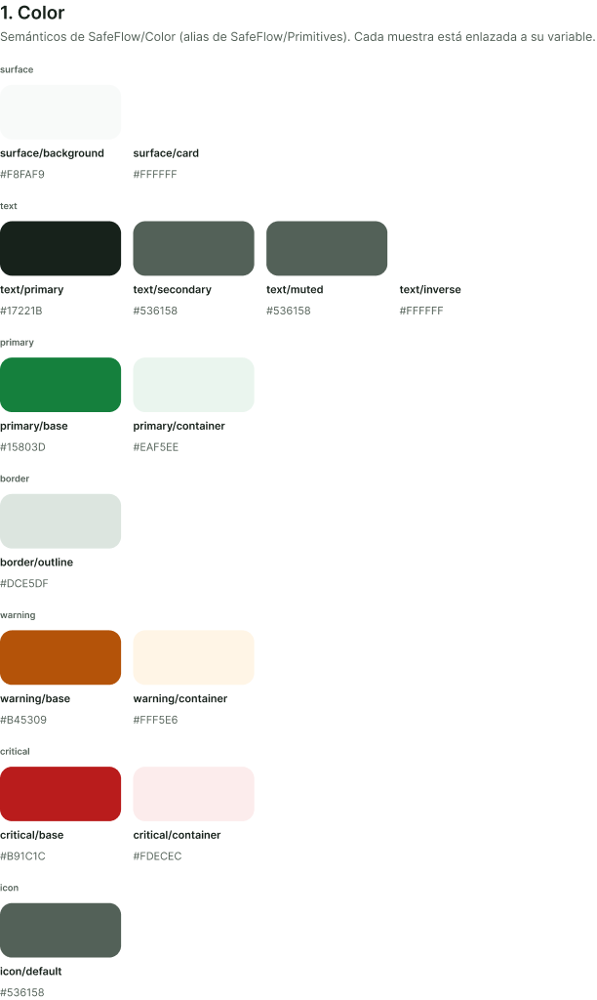

<strong><em>Nota.</em></strong> Captura del sistema de diseño de Figma. Cada muestra está enlazada a una variable de color de SafeFlow/Color, alias de las primitivas.

<strong>Tabla 82.</strong> <em>Tokens de color y su función</em>

| Token | Valor | Función |
|---|---|---|
| surface/background | `#F8FAF9` | Fondo de pantalla |
| surface/card | `#FFFFFF` | Superficie de tarjetas, campos y barra inferior |
| text/primary | `#17221B` | Texto principal |
| text/secondary, text/muted, icon/default | `#536158` | Texto secundario e iconos |
| text/inverse | `#FFFFFF` | Texto sobre fondos de acento |
| primary/base | `#15803D` | Acciones principales, estado normal, elemento activo |
| primary/container | `#EAF5EE` | Fondo de elemento seleccionado y avisos informativos |
| border/outline | `#DCE5DF` | Bordes de tarjetas, campos y botones secundarios |
| warning/base | `#B45309` | Estado «En riesgo» y advertencia térmica |
| warning/container | `#FFF5E6` | Fondo de avisos de advertencia |
| critical/base | `#B91C1C` | Estado «Crítico», excursión térmica y errores |
| critical/container | `#FDECEC` | Fondo de avisos críticos |

<strong><em>Nota.</em></strong> Los valores corresponden a los tokens implementados en la aplicación.

Como se observa en la Tabla 82, el color nunca es la única señal de estado: cada estado térmico va acompañado de una etiqueta textual («Normal», «En riesgo», «Crítico») y de un icono, de modo que la información se entiende también sin percibir el color.

**Espaciado, radios e iconografía.** El espaciado sigue una escala de 4, 8, 12, 16, 24, 32 y 48 dp, y los radios de esquina son 8 dp (pequeño), 12 dp (mediano), 20 dp (grande) y completo para chips y píldoras. La Figura 48 los ilustra. Los iconos provienen de Material Symbols Rounded en formato local (peso 400, FILL 0, GRAD 0, tamaño óptico 24), con la licencia Apache 2.0; los recursos son locales y no se descargan en tiempo de ejecución.

<strong>Figura 48.</strong> <em>Radios de esquina y escala de espaciado</em>

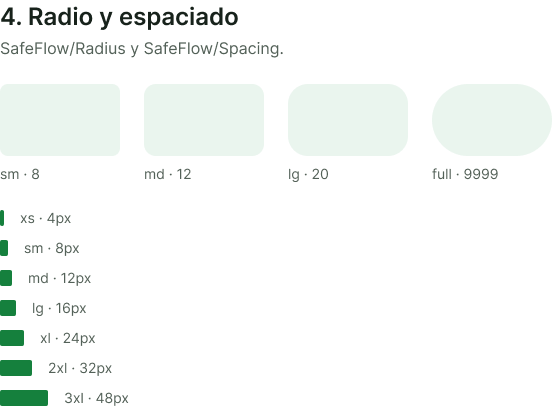

<strong><em>Nota.</em></strong> Captura del sistema de diseño de Figma (SafeFlow/Radius y SafeFlow/Spacing).

La Figura 48 permite verificar que el ritmo de la interfaz descansa en múltiplos de 4 dp y en tres radios, suficientes para distinguir campos, tarjetas y chips sin ornamentos adicionales.

**Tono de voz.** El enunciado propone cuatro ejes para el tono de comunicación. SafeFlow adopta la siguiente posición, justificada por el dominio:

| Eje | Posición | Justificación |
|---|---|---|
| Divertido / Serio | **Serio** | Se comunican temperaturas, riesgos y bloqueos de envío con consecuencias sanitarias y económicas; el humor restaría credibilidad. |
| Formal / Casual | **Formal** | Los usuarios son personal de logística y calidad en un contexto laboral; se usan frases completas, términos del dominio y sin coloquialismos. |
| Respetuoso / Irreverente | **Respetuoso** | Los errores se formulan sin culpar («Ingresa una cantidad positiva») y las acciones críticas explican su motivo. |
| Entusiasta / Sereno | **Sereno** | Ante una excursión térmica se necesita calma para decidir; los avisos informan hechos y siguiente paso, sin exclamaciones ni alarmismo. |

<strong>Tabla 83.</strong> <em>Tono de comunicación de SafeFlow</em>

<strong><em>Nota.</em></strong> Posición elegida en cada eje propuesto por el enunciado.

La Tabla 83 resume un tono serio, formal, respetuoso y sereno, coherente con ejemplos reales de la interfaz como «Las mediciones disponibles permiten continuar con el envío».

**Principios de diseño y accesibilidad.** El diseño aplica cuatro principios. (1) *Jerarquía visual*: la temperatura actual se muestra en tamaño Headline o Title, por encima del detalle secundario. (2) *Consistencia*: un único conjunto de componentes y tokens para todas las pantallas. (3) *Retroalimentación*: cada estado (datos completos, vacío, error) tiene un diseño propio y los botones deshabilitados no ejecutan acciones. (4) *Diseño inclusivo*: los objetivos táctiles miden al menos 48 dp (los chips de Figma tienen 44 dp visuales y en Android se amplía el área de interacción a 48 dp), los controles significativos exponen una descripción accesible y los iconos decorativos no se anuncian, y el estado no depende solo del color. Las medidas se adaptan al contenido, sin alturas fijas que recorten texto con tamaños de fuente grandes.

**Componentes.** El sistema define 13 familias de componentes genéricos, que reciben texto y callbacks y no conocen la lógica de negocio. La Tabla 84 las lista con su contrato público en Android.

<strong>Tabla 84.</strong> <em>Familias de componentes SafeFlow</em>

| Familia | Composable | Propósito |
|---|---|---|
| Icon | `SafeFlowIcon` | Icono con descripción accesible opcional |
| Typography | `SafeFlowText` | Texto con variante de la escala tipográfica |
| Button | `SafeFlowButton` | Acción principal, tonal, secundaria, crítica o de texto |
| Icon Button | `SafeFlowIconButton` | Acción compacta con icono (volver, cuenta) |
| Text Field | `SafeFlowTextField` | Campo con etiqueta, ayuda, error y modo contraseña |
| Checkbox | `SafeFlowCheckbox` | Selección binaria (términos, permisos) |
| Chip | `SafeFlowChip` | Filtro seleccionable |
| List Card | `SafeFlowListCard` | Tarjeta de producto, lote, alerta, despacho o lectura |
| Callout | `SafeFlowCallout` | Aviso informativo, de advertencia o crítico |
| Nav Item | `SafeFlowNavItem` | Elemento de navegación con icono y etiqueta |
| App Header | `SafeFlowAppHeader` | Encabezado con título, volver y cuenta |
| Brand | `SafeFlowBrand` | Logotipo con tagline opcional |
| Bottom Navigation | `SafeFlowBottomNavigation` | Barra inferior por rol |

<strong><em>Nota.</em></strong> Contratos definidos en el módulo `core/ui` de la aplicación. El gráfico térmico no forma parte de este conjunto porque depende de datos del contexto Environmental Monitoring.

Dos componentes merecen detalle. Los botones, mostrados en la Figura 49, miden 48 dp de alto y tienen cinco variantes: primaria (relleno verde), tonal (contenedor verde claro), secundaria (borde), crítica (relleno rojo) y de texto. La barra de navegación inferior, en la Figura 50, es una barra fija compartida por rol: sus destinos son instancias configurables y no concede permisos adicionales.

<strong>Figura 49.</strong> <em>Variantes del componente Button</em>

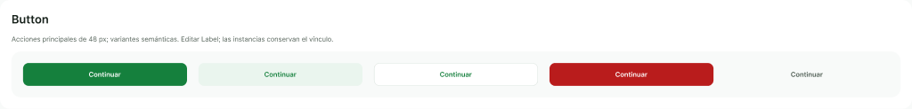

<strong><em>Nota.</em></strong> Captura del sistema de diseño de Figma. Las instancias conservan el vínculo con el componente y solo se edita la etiqueta.

<strong>Figura 50.</strong> <em>Navegación inferior por rol</em>

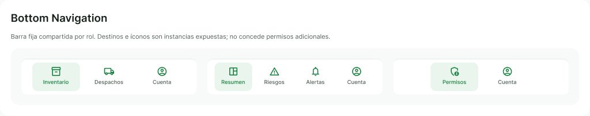

<strong><em>Nota.</em></strong> Captura del sistema de diseño de Figma. De izquierda a derecha, las barras de OPERADOR, SUPERVISOR y ADMIN, con el destino activo resaltado en contenedor verde.

La Figura 49 y la Figura 50 cierran las guías de estilo mostrando los dos componentes de mayor recurrencia: el botón, que codifica la jerarquía de acciones, y la barra inferior, que codifica el alcance de cada rol.

### 3.1.2. Information Architecture

La arquitectura de información define cómo se agrupa, nombra, busca y recorre el contenido de la aplicación para que cada rol encuentre lo que necesita sin esfuerzo. Se derivó de las 17 pantallas diseñadas, de los permisos de cada rol y de los flujos de las historias de usuario. Al ser una aplicación de tareas operativas, la estructura sigue el vocabulario del dominio (producto, lote, despacho, alerta) y evita jerarquías profundas: la mayoría de las tareas se alcanzan en dos o tres toques desde la barra inferior.

#### 3.1.2.1. Organization Systems

El contenido se organiza con tres esquemas visuales y cuatro de categorización, aplicados según el grupo de información, como resume la Tabla 85.

<strong>Tabla 85.</strong> <em>Sistemas de organización por grupo de información</em>

| Grupo de información | Organización visual | Categorización | Ejemplo |
|---|---|---|---|
| Destinos de la aplicación | Jerárquica (barra inferior y pantalla de detalle) | Según audiencia (rol) | OPERADOR: Inventario, Despachos; SUPERVISOR: Resumen, Riesgos, Alertas |
| Contenido de una pantalla | Jerárquica (título, filtros, acción principal, lista) | Por tópicos | Inventario: título, chips, «Registrar producto», tarjetas |
| Registro de datos | Secuencial (paso a paso) | Por tópicos | Registrar producto, luego lote, luego ingreso de stock |
| Despacho | Secuencial | Por estado | Registro, validación térmica, envío, entrega |
| Lecturas de temperatura | Jerárquica (gráfico y lista) | Cronológica | Historial térmico por «Hoy» o «Periodo» |
| Alertas | Jerárquica | Por estado y severidad | Activas e Historial; crítica y advertencia |
| Permisos | Matricial (rol por operación) | Según audiencia | Casillas por operación para OPERADOR y SUPERVISOR |
| Productos y despachos | Jerárquica (lista a detalle) | Por estado | Normal, En riesgo, Crítico; En tránsito, Entregados |

<strong><em>Nota.</em></strong> Elaboración propia a partir de las pantallas de Figma.

La Tabla 85 muestra que la audiencia es el primer criterio de organización (cada rol tiene su propia barra inferior) y que, dentro de cada destino, prima el estado del dato (Normal, En riesgo, Crítico) sobre un orden alfabético, porque la prioridad del usuario es identificar qué requiere atención. Las listas de lecturas son cronológicas porque la causalidad térmica depende del orden temporal. Los registros se presentan como formularios cortos de un solo paso para no fragmentar tareas frecuentes, y el despacho es secuencial por naturaleza del proceso de negocio.

#### 3.1.2.2. Labelling Systems

Las etiquetas usan el lenguaje del dominio, en español, con el mínimo de palabras y de manera consistente entre botones, encabezados y filtros. La Tabla 86 recoge las etiquetas principales y lo que representan.

<strong>Tabla 86.</strong> <em>Etiquetas principales de la interfaz</em>

| Etiqueta | Dónde aparece | Qué representa |
|---|---|---|
| Inventario | Barra inferior (OPERADOR) | Productos, lotes y stock |
| Despachos | Barra inferior (OPERADOR) | Seguimiento de envíos |
| Resumen | Barra inferior (SUPERVISOR) | Indicadores consolidados |
| Riesgos | Barra inferior (SUPERVISOR) | Productos en riesgo y su historial térmico |
| Alertas | Barra inferior (SUPERVISOR) | Incidencias activas e historial |
| Permisos | Barra inferior (ADMIN) | Operaciones permitidas por rol |
| Cuenta | Barra inferior e icono de encabezado | Datos de la sesión y cierre de sesión |
| Registrar producto / lote / ingreso / despacho | Botones | Comandos en imperativo que crean un registro |
| Normal · En riesgo · Crítico | Chips y estados de tarjeta | Estado de conservación según el rango del producto |
| Activas · Historial | Chips de Alertas | Alertas pendientes o ya atendidas |
| Todos · En tránsito · Entregados | Chips de Despachos | Estado del despacho |
| Hoy · Periodo | Chips de Historial térmico | Ventana de consulta de lecturas |
| Excursión térmica · Advertencia térmica | Tarjetas de alerta | Temperatura fuera del rango o cerca del límite |
| Continuar con el despacho | Validación del despacho | Autoriza el envío cuando la condición térmica es admisible |

<strong><em>Nota.</em></strong> Elaboración propia; los términos coinciden con el lenguaje ubicuo del dominio.

La Tabla 86 evidencia dos reglas: los botones usan verbos en imperativo y los estados usan sustantivos o adjetivos cortos. Las asociaciones se mantienen mediante etiquetas coherentes: «Registrar lote» y «Registrar ingreso» se ofrecen en el detalle de un producto, donde el usuario ya tiene el contexto.

#### 3.1.2.3. SEO Tags and Meta Tags

SafeFlow se distribuye como aplicación Android, por lo que el equivalente a las etiquetas SEO son los elementos de App Store Optimization (ASO) de su ficha en la tienda. La Tabla 87 propone los valores. Aunque en esta entrega ya se presenta el diseño de la landing page en la sección 3.1.3, sus etiquetas Title, Description, Keywords y Author quedan pendientes de definición para la implementación web.

<strong>Tabla 87.</strong> <em>Elementos ASO de la ficha de SafeFlow</em>

| Elemento | Valor propuesto |
|---|---|
| App Title | SafeFlow: Cadena de frío |
| App Subtitle (descripción corta) | Supervisa temperaturas, alertas y despachos de tus productos sensibles. |
| App Keywords | cadena de frío, monitoreo de temperatura, supervisión térmica, inventario, despachos, alertas, productos farmacéuticos, alimentos perecederos, trazabilidad, logística |
| App Description | SafeFlow te ayuda a proteger la cadena de frío de medicamentos y alimentos. Registra productos y lotes con su rango de temperatura, consulta la última lectura de cada sensor y recibe avisos cuando una temperatura sale del rango. Los supervisores priorizan las alertas por severidad, registran la acción correctiva y revisan el historial térmico. Los operadores registran despachos, validan la condición térmica antes del envío y confirman la entrega. Los administradores definen qué operaciones puede realizar cada rol. Disponible para celulares y tabletas Android. |
| Categoría sugerida | Negocios (herramientas de logística) |

<strong><em>Nota.</em></strong> Textos propuestos por el equipo para la publicación futura; el título y el subtítulo respetan los límites habituales de la tienda.

> Pendiente: SEO Tags y Meta Tags de la landing page (Title, Description, Keywords, Author), que se definirán junto con su implementación web.

La Tabla 87 mantiene coherencia con el producto real: menciona únicamente capacidades diseñadas (inventario, monitoreo, alertas, despachos y permisos) y usa el vocabulario del dominio para que los términos de búsqueda coincidan con lo que el usuario espera encontrar.

#### 3.1.2.4. Searching Systems

La aplicación no ofrece búsqueda de texto libre en esta versión: el volumen de datos por rol es acotado y el diseño favorece el filtrado por estado, que responde directamente a la pregunta operativa «qué requiere atención». Los filtros se implementan con chips seleccionables (de selección única) ubicados bajo el título de la pantalla; después de filtrar, la lista se actualiza conservando el mismo formato de tarjeta y, si no hay resultados, se muestra un estado vacío con un mensaje explicativo. La Tabla 88 resume los medios de búsqueda por pantalla.

<strong>Tabla 88.</strong> <em>Filtros y ayudas de búsqueda por pantalla</em>

| Pantalla | Filtro | Opciones | Resultado |
|---|---|---|---|
| Inventario | Estado de conservación | Todos, Normal, En riesgo | Tarjetas de producto con temperatura y rango |
| Despachos | Estado del despacho | Todos, En tránsito, Entregados | Tarjetas de despacho con producto, destino y sensor |
| Alertas | Estado de la alerta | Activas, Historial | Tarjetas ordenadas con severidad, producto y hora |
| Historial térmico | Periodo | Hoy, Periodo | Gráfico y lecturas en orden cronológico |
| Permisos por rol | Rol | OPERADOR, SUPERVISOR | Casillas de operaciones del rol elegido |
| Registrar despacho | Selección guiada | Seleccionar producto, Seleccionar sensor | Valores asociados al nuevo despacho |

<strong><em>Nota.</em></strong> Elaboración propia a partir de los chips y selectores de las pantallas de Figma.

Según la Tabla 88, los filtros reemplazan a la búsqueda abierta en las listas principales y la selección guiada evita errores de transcripción al registrar un despacho.

#### 3.1.2.5. Navigation Systems

La navegación combina tres técnicas: navegación inferior global por rol, navegación jerárquica de lista a detalle con botón de retorno, y acceso a la cuenta mediante icono en el encabezado. La barra inferior se muestra siempre en las pantallas autenticadas y su contenido depende del rol: OPERADOR (Inventario, Despachos, Cuenta), SUPERVISOR (Resumen, Riesgos, Alertas, Cuenta) y ADMIN (Permisos, Cuenta), como se vio en la Figura 50. En una tableta se mantiene la misma barra y las listas se reorganizan en dos columnas.

Las pantallas de detalle y de registro (Detalle de producto, Registrar lote, Validación del despacho) conservan el destino activo de la barra y añaden un botón de retorno en el encabezado. El estado de acceso determina el punto de entrada: un VISITANTE solo ve Iniciar sesión y Crear cuenta; al autenticarse, la aplicación lleva al primer destino de su rol. Desde Cuenta se cierra la sesión, y una sesión cerrada o expirada devuelve al estado de VISITANTE. El diagrama de la Figura 51 resume el sistema.

<strong>Figura 51.</strong> <em>Mapa de navegación por estado de acceso y rol</em>

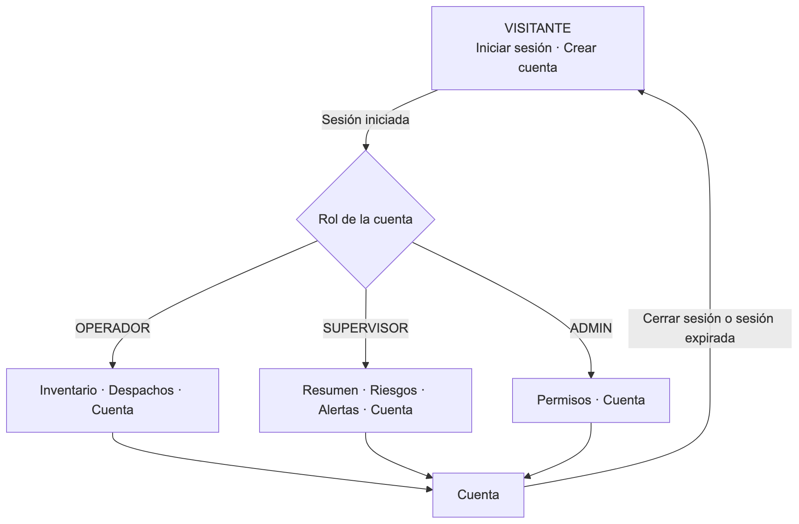

<strong><em>Nota.</em></strong> Elaboración propia. Los destinos entre paréntesis de la barra inferior dependen del rol; Cuenta está disponible en los tres.

La Figura 51 confirma que existe una sola salida común (Cuenta) y que el rol define el alcance, lo que evita que el usuario encuentre opciones sobre las que no tiene permiso.

### 3.1.3. Landing Page UI Design

La landing page de SafeFlow presenta la propuesta de valor de la solución para empresas farmacéuticas, alimentarias y operadores logísticos que necesitan controlar su cadena de frío. Su arquitectura de información organiza el contenido en una navegación principal, una sección hero, la propuesta de valor, las funcionalidades, el flujo de uso, la tecnología, los planes, los beneficios, el equipo, los sectores beneficiados, las preguntas frecuentes y un formulario de contacto. El diseño mantiene el lenguaje visual definido en la sección 3.1.1 y utiliza llamadas a la acción orientadas a solicitar una demostración o iniciar una conversación comercial.

#### 3.1.3.1. Wireframe

Los wireframes de la landing page representan la estructura, la jerarquía y la distribución de los contenidos antes de aplicar colores, fotografías e iconografía. Se definieron siete bloques de baja fidelidad para comprobar el recorrido completo de la página: encabezado y hero, propuesta de valor, funcionalidades y proceso, tecnología y confianza, planes, beneficios y equipo, y preguntas frecuentes con contacto y pie de página. La navegación superior permanece visible como referencia y las llamadas a la acción se ubican en los puntos de conversión principales.

La Figura 52 presenta el wireframe general de la landing page: encabezado, hero, tarjetas de funcionalidades, bloque de preguntas frecuentes y pie de página.

<strong>Figura 52.</strong> <em>Wireframe general de la landing page</em>

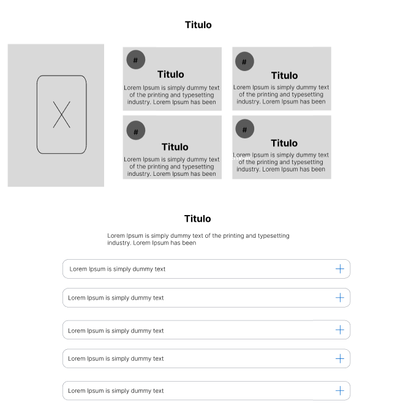

<strong><em>Nota.</em></strong> Elaboración propia a partir de la estructura de la landing page de SafeFlow.

La Figura 53 muestra el bloque de contacto, con un formulario de datos a la izquierda y la información de contacto junto con un espacio para mapa o ubicación a la derecha.

<strong>Figura 53.</strong> <em>Wireframe del formulario de contacto</em>

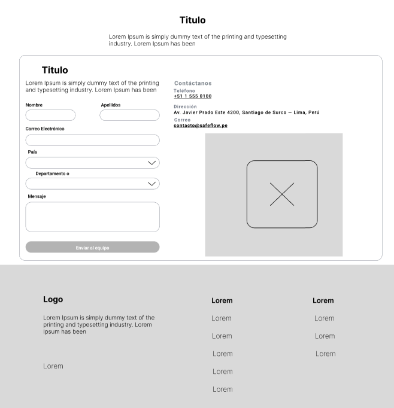

<strong><em>Nota.</em></strong> Elaboración propia a partir de la estructura de la landing page de SafeFlow.

La Figura 54 organiza la propuesta de valor y la vista de plataforma mediante tarjetas informativas, una imagen de apoyo y una galería de dispositivos o pantallas.

<strong>Figura 54.</strong> <em>Wireframe de la propuesta de valor y la plataforma</em>

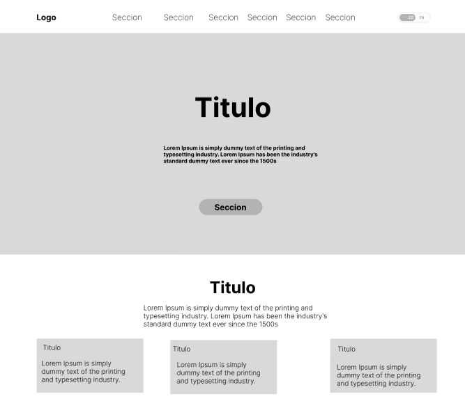

<strong><em>Nota.</em></strong> Elaboración propia a partir de la estructura de la landing page de SafeFlow.

La Figura 55 presenta la distribución de las funcionalidades, el proceso de uso y los elementos de confianza, con tarjetas repetibles y una imagen destacada.

<strong>Figura 55.</strong> <em>Wireframe de funcionalidades, proceso y tecnología</em>

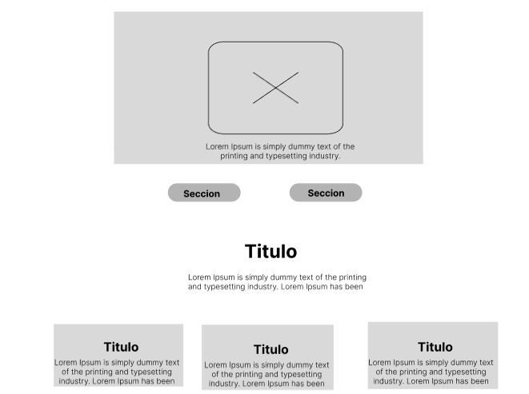

<strong><em>Nota.</em></strong> Elaboración propia a partir de la estructura de la landing page de SafeFlow.

La Figura 56 muestra la sección de planes, con tres alternativas de servicio y sus respectivas listas de beneficios y llamadas a la acción.

<strong>Figura 56.</strong> <em>Wireframe de planes comerciales</em>

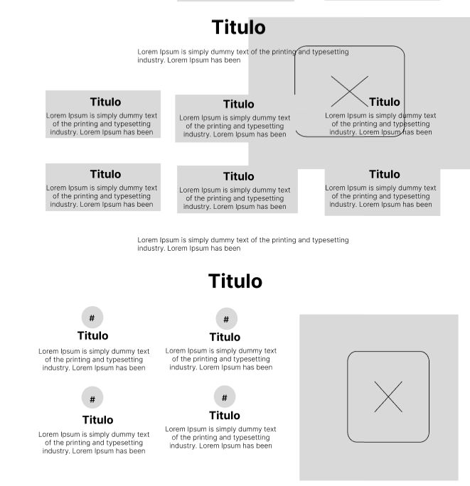

<strong><em>Nota.</em></strong> Elaboración propia a partir de la estructura de la landing page de SafeFlow.

La Figura 57 presenta los beneficios de SafeFlow, la descripción del equipo y los sectores que pueden utilizar la solución, organizados en bloques comparables.

<strong>Figura 57.</strong> <em>Wireframe de beneficios, equipo y sectores</em>

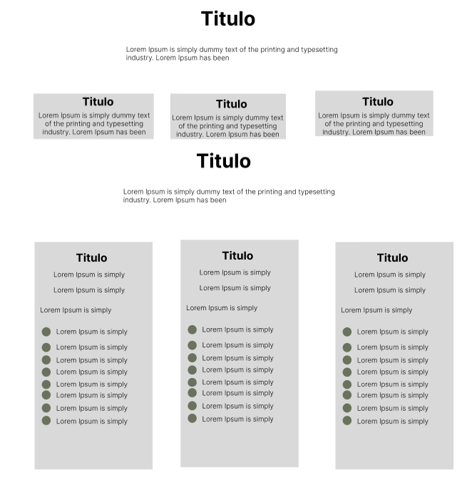

<strong><em>Nota.</em></strong> Elaboración propia a partir de la estructura de la landing page de SafeFlow.

La Figura 58 cierra el recorrido con las preguntas frecuentes, la llamada a la acción final, el formulario de contacto y el pie de página con enlaces de navegación.

<strong>Figura 58.</strong> <em>Wireframe de preguntas frecuentes y cierre</em>

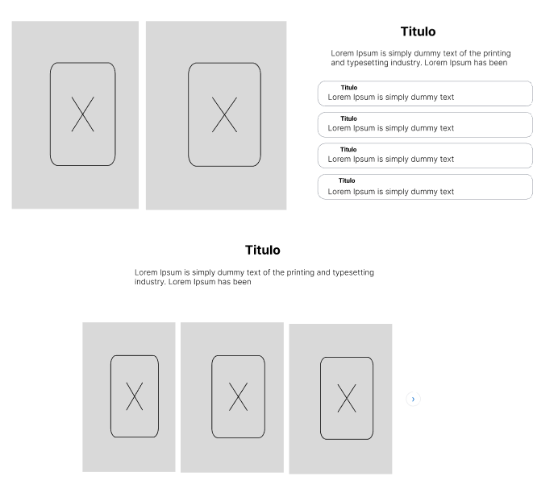

<strong><em>Nota.</em></strong> Elaboración propia a partir de la estructura de la landing page de SafeFlow.

#### 3.1.3.2. Mock-up

Los mock-ups aplican el sistema visual de SafeFlow a la estructura definida en los wireframes. La propuesta utiliza una base clara, azul como color de acción y confianza, naranja para destacar llamadas de atención y fotografías relacionadas con almacenes, transporte y operaciones de cadena de frío. Las composiciones priorizan una lectura progresiva: primero se comunica el problema y la propuesta de valor, luego se explican las capacidades y finalmente se facilita la conversión mediante planes, preguntas frecuentes y contacto.

La Figura 59 muestra la sección de funcionalidades y el proceso de uso de SafeFlow, con tarjetas para el monitoreo, las alertas, el inventario, la trazabilidad, la aplicación móvil y la seguridad.

<strong>Figura 59.</strong> <em>Mock-up de funcionalidades y proceso de uso</em>

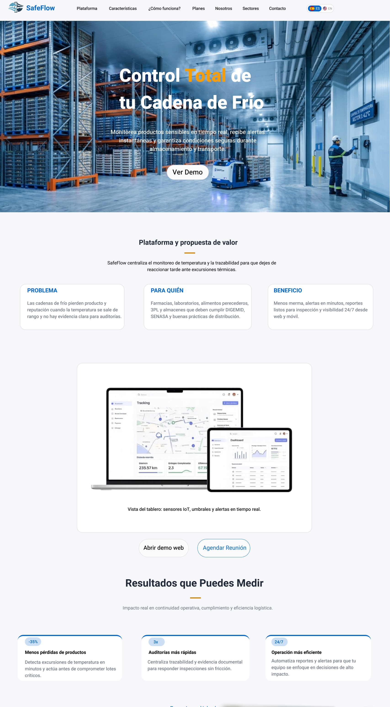

<strong><em>Nota.</em></strong> Elaboración propia. La composición aplica el sistema visual de SafeFlow a la landing page.

La Figura 60 presenta el hero de la landing page y la propuesta de valor: el mensaje principal, la llamada a ver una demostración, los segmentos atendidos, los resultados esperados y una vista de la plataforma.

<strong>Figura 60.</strong> <em>Mock-up del hero y la propuesta de valor</em>

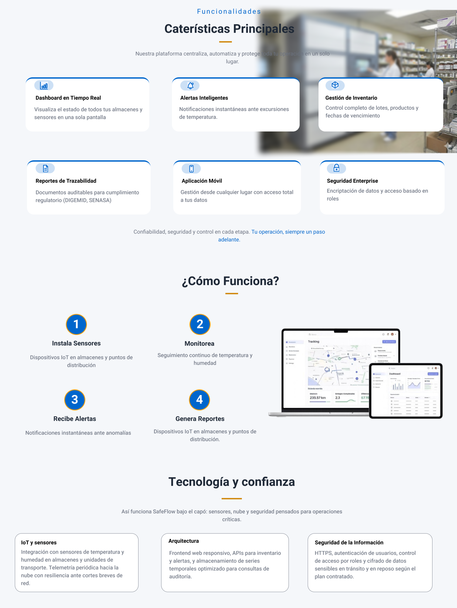

<strong><em>Nota.</em></strong> Elaboración propia. La composición aplica el sistema visual de SafeFlow a la landing page.

La Figura 61 muestra las preguntas frecuentes y el cierre de conversión, incluyendo el formulario para dejar los datos, los canales de contacto, la ubicación y el pie de página.

<strong>Figura 61.</strong> <em>Mock-up de preguntas frecuentes y contacto</em>

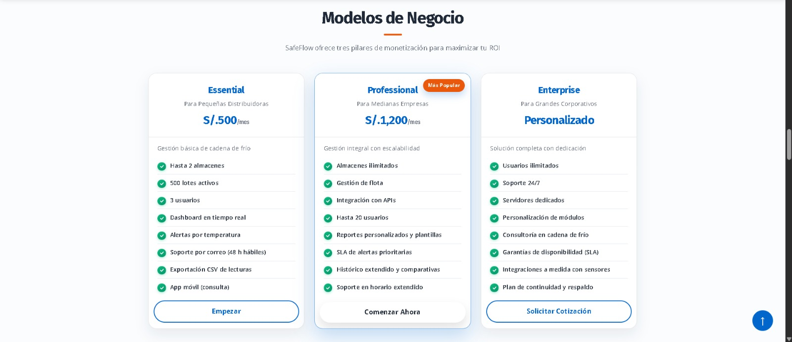

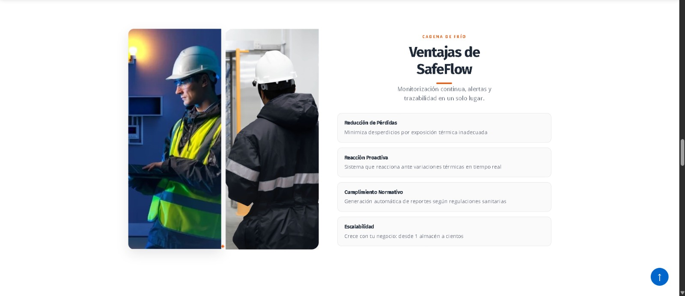

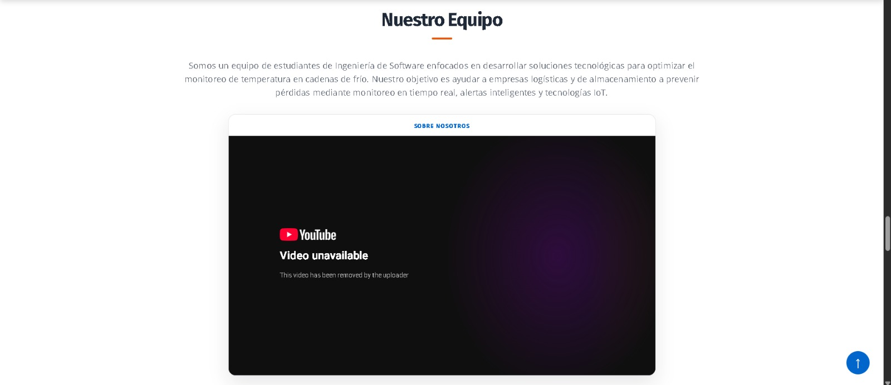

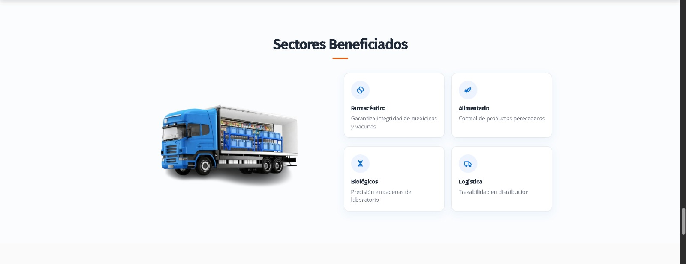

<strong><em>Nota.</em></strong> Elaboración propia. La composición aplica el sistema visual de SafeFlow a la landing page.

La Figura 62 presenta los modelos de negocio y los planes comerciales, junto con los beneficios, el equipo y los sectores beneficiados por SafeFlow.

<strong>Figura 62.</strong> <em>Mock-up de planes, beneficios y sectores</em>

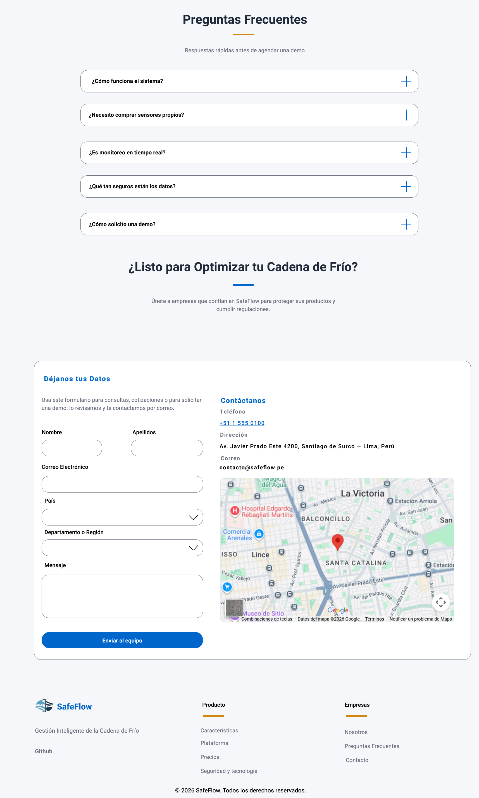

<strong><em>Nota.</em></strong> Elaboración propia. La composición aplica el sistema visual de SafeFlow a la landing page.

### 3.1.4. Mobile Applications UX/UI Design

Esta sección presenta la propuesta visual y de interacción de la aplicación móvil principal de SafeFlow, diseñada para celular (390 x 844 dp) y tableta (768 x 1024 dp). El diseño en Figma está organizado por actor de acceso y por dispositivo: las secciones 01 VISITANTE, 02 USUARIO AUTENTICADO, 03 OPERADOR, 04 SUPERVISOR y 05 ADMIN. Cada pantalla se numera del 1 al 17 (1 Iniciar sesión, 2 Crear cuenta, 3 Resumen, 4 Inventario, 5 Registrar producto, 6 Detalle de producto, 7 Registrar lote, 8 Registrar ingreso, 9 Historial térmico, 10 Productos en riesgo, 11 Alertas, 12 Detalle de incidente, 13 Despachos, 14 Detalle de despacho, 15 Validación del despacho, 16 Permisos por rol, 17 Registrar despacho) y se declina en estados (datos completos, vacío, error y confirmación), con lo que suma 118 marcos por dispositivo.

#### 3.1.4.1. Wireframes

Los wireframes representan la estructura de cada pantalla sin color de marca ni imágenes: bloques de encabezado, filtros, tarjetas, campos y barra inferior, ubicados según la arquitectura de información de 3.1.2. Existe un wireframe por cada mock-up y estado, en la página de wireframes de Figma, organizada por actor (VISITANTE, USUARIO AUTENTICADO, OPERADOR, SUPERVISOR, ADMIN) y por dispositivo (celular de 390 x 844 dp y tableta de 768 x 1024 dp) sobre una grilla de cinco columnas. Los wireframes aplican el principio de consistencia (misma posición del encabezado, el filtro y la acción principal en todas las pantallas), el diseño inclusivo (objetivos táctiles de 48 dp y etiquetas visibles) y la jerarquía de la información (el valor térmico se destaca sobre el detalle). Las figuras siguientes muestran una pantalla representativa por cada tarea principal; el conjunto completo está en el archivo de Figma [SafeFlow](https://www.figma.com/design/ebf6YJVRmfKTHq2EDicpix/Safeflow?node-id=3-3705).

La Figura 63 presenta el wireframe de Iniciar sesión (VISITANTE, US-31): campos de correo y contraseña, acción principal y acceso a la recuperación de acceso.

<strong>Figura 63.</strong> <em>Wireframe Iniciar sesión</em>

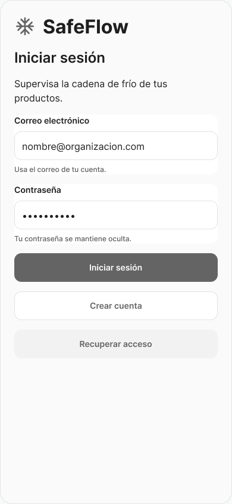

<strong><em>Nota.</em></strong> Marco de la página safeflow_wireframes de Figma, sección VISITANTE.

La Figura 64 presenta el wireframe de Crear cuenta (VISITANTE, US-30): campos de registro, aceptación de términos y acción principal.

<strong>Figura 64.</strong> <em>Wireframe Crear cuenta</em>

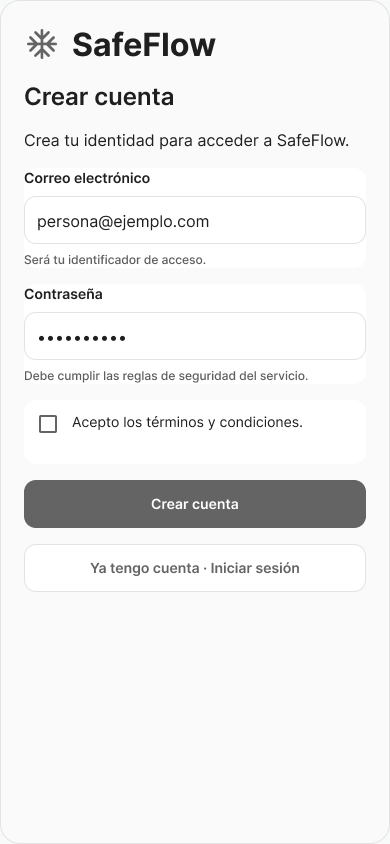

<strong><em>Nota.</em></strong> Marco de la página safeflow_wireframes de Figma, sección VISITANTE.

La Figura 65 presenta el wireframe de Resumen (SUPERVISOR, US-13): indicadores consolidados de productos, alertas y despachos.

<strong>Figura 65.</strong> <em>Wireframe Resumen</em>

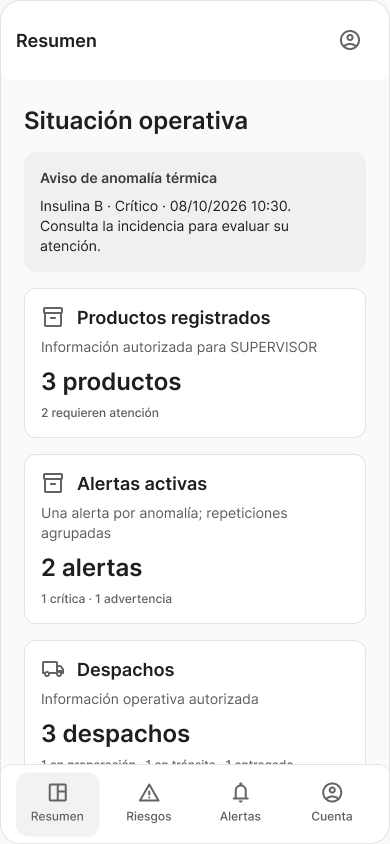

<strong><em>Nota.</em></strong> Marco de la página safeflow_wireframes de Figma, sección SUPERVISOR.

La Figura 66 presenta el wireframe de Inventario (OPERADOR, US-10): chips de filtro por estado, acción Registrar producto y tarjetas con temperatura, rango y estado.

<strong>Figura 66.</strong> <em>Wireframe Inventario</em>

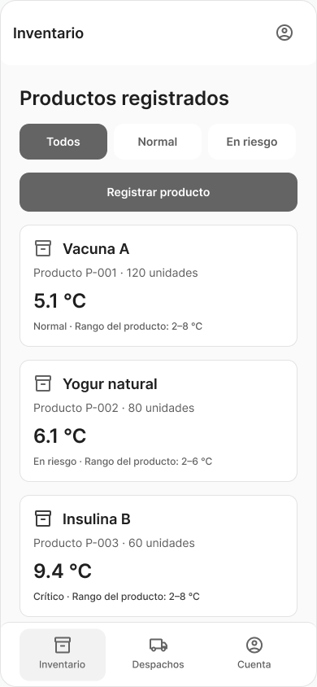

<strong><em>Nota.</em></strong> Marco de la página safeflow_wireframes de Figma, sección OPERADOR.

La Figura 67 presenta el wireframe de Registrar producto (OPERADOR, US-01): campos de nombre y rango térmico mínimo y máximo, con acción de guardado.

<strong>Figura 67.</strong> <em>Wireframe Registrar producto</em>

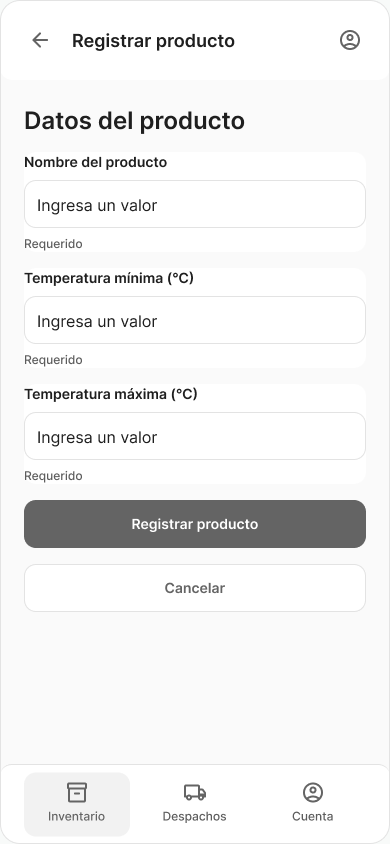

<strong><em>Nota.</em></strong> Marco de la página safeflow_wireframes de Figma, sección OPERADOR.

La Figura 68 presenta el wireframe de Detalle de producto (OPERADOR, US-03): temperatura actual, disponibilidad del sensor y datos del producto.

<strong>Figura 68.</strong> <em>Wireframe Detalle de producto</em>

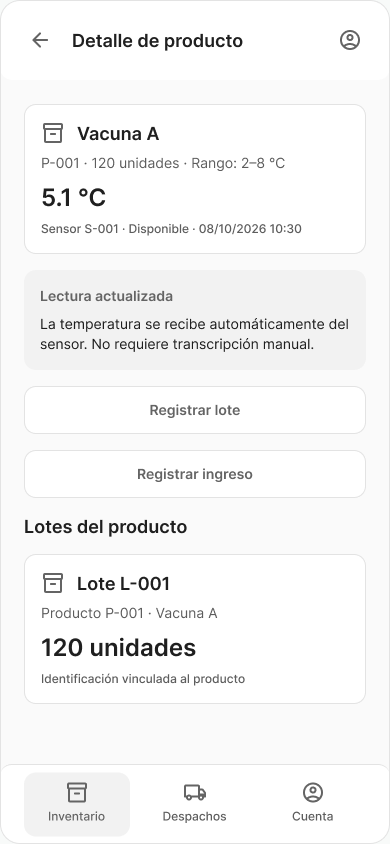

<strong><em>Nota.</em></strong> Marco de la página safeflow_wireframes de Figma, sección OPERADOR.

La Figura 69 presenta el wireframe de Registrar lote (OPERADOR, US-19): campo de identificación del lote y producto al que se asocia.

<strong>Figura 69.</strong> <em>Wireframe Registrar lote</em>

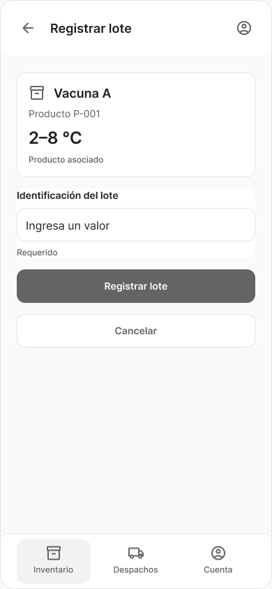

<strong><em>Nota.</em></strong> Marco de la página safeflow_wireframes de Figma, sección OPERADOR.

La Figura 70 presenta el wireframe de Registrar ingreso (OPERADOR, US-02): stock actual y campo de cantidad de unidades que ingresan.

<strong>Figura 70.</strong> <em>Wireframe Registrar ingreso</em>

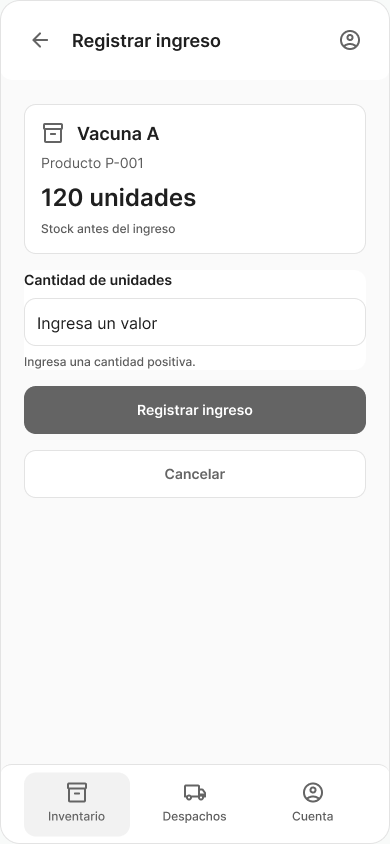

<strong><em>Nota.</em></strong> Marco de la página safeflow_wireframes de Figma, sección OPERADOR.

La Figura 71 presenta el wireframe de Historial térmico (SUPERVISOR, US-17): selector de periodo y lista de lecturas con fecha, hora y estado.

<strong>Figura 71.</strong> <em>Wireframe Historial térmico</em>

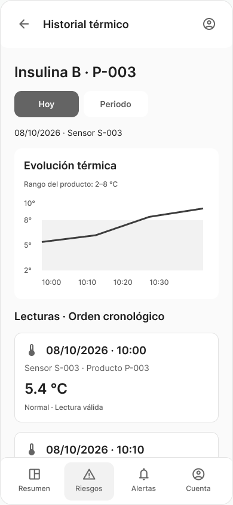

<strong><em>Nota.</em></strong> Marco de la página safeflow_wireframes de Figma, sección SUPERVISOR.

La Figura 72 presenta el wireframe de Alertas (SUPERVISOR, US-55): alertas activas con severidad y acceso al detalle del incidente.

<strong>Figura 72.</strong> <em>Wireframe Alertas</em>

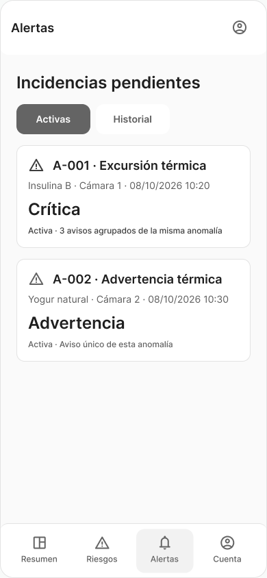

<strong><em>Nota.</em></strong> Marco de la página safeflow_wireframes de Figma, sección SUPERVISOR.

La Figura 73 presenta el wireframe de Despachos (OPERADOR, US-25): chips por estado, acción Registrar despacho y tarjetas de cada despacho.

<strong>Figura 73.</strong> <em>Wireframe Despachos</em>

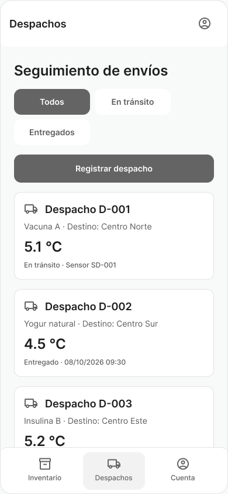

<strong><em>Nota.</em></strong> Marco de la página safeflow_wireframes de Figma, sección OPERADOR.

La Figura 74 presenta el wireframe de Validación del despacho (OPERADOR, US-47): resultado de la condición térmica y acciones para continuar, confirmar o volver.

<strong>Figura 74.</strong> <em>Wireframe Validación del despacho</em>

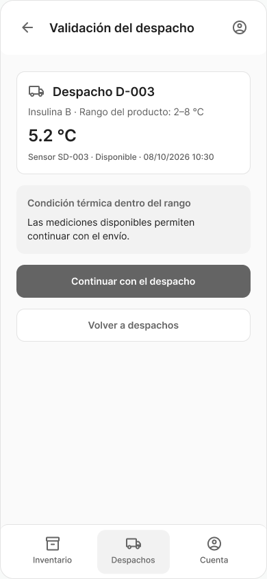

<strong><em>Nota.</em></strong> Marco de la página safeflow_wireframes de Figma, sección OPERADOR.

La Figura 75 presenta el wireframe de Permisos por rol (ADMIN, US-18): operaciones configurables por rol y acción de guardado.

<strong>Figura 75.</strong> <em>Wireframe Permisos por rol</em>

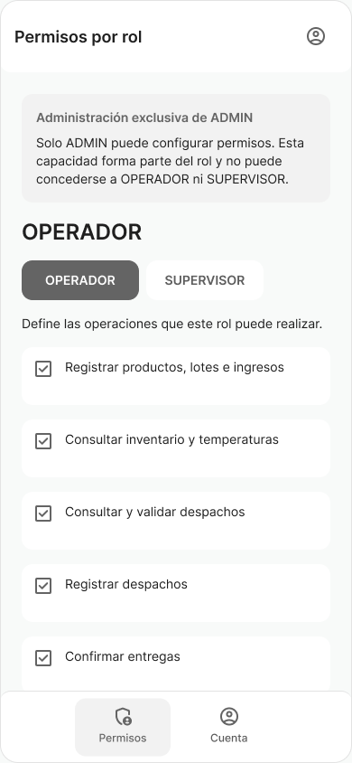

<strong><em>Nota.</em></strong> Marco de la página safeflow_wireframes de Figma, sección ADMIN.

La Figura 76 presenta el wireframe de Registrar despacho (OPERADOR, US-61): selección de producto, lote, cantidad, destino y sensor.

<strong>Figura 76.</strong> <em>Wireframe Registrar despacho</em>

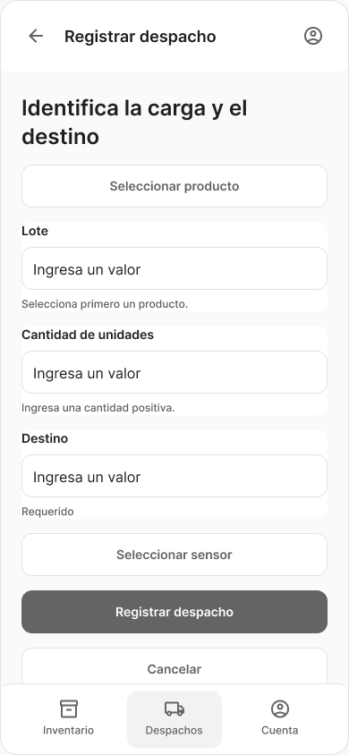

<strong><em>Nota.</em></strong> Marco de la página safeflow_wireframes de Figma, sección OPERADOR.

La Figura 77 presenta el wireframe de Inventario en tableta (OPERADOR, US-34): la misma pantalla de inventario adaptada al ancho de 768 dp.

<strong>Figura 77.</strong> <em>Wireframe Inventario en tableta</em>

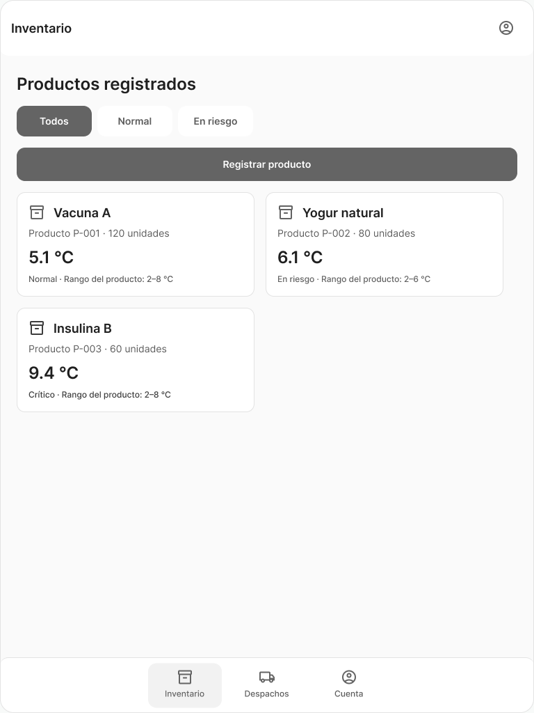

<strong><em>Nota.</em></strong> Marco de la página safeflow_wireframes de Figma, sección OPERADOR.

#### 3.1.4.2. Wireflow Diagrams

Los wireflows enlazan los wireframes de una misma tarea para mostrar cómo cambia la pantalla tras cada interacción. Cada wireflow parte de un actor y de una pantalla de inicio, representa las decisiones del sistema con nodos de decisión y recorre tanto la ruta esperada como las alternativas de error, vacío o bloqueo, de modo que cada estado diseñado queda alcanzable desde su inicio. Se elaboró un wireflow por objetivo de usuario (17 en total, versión celular), en una sola página de Figma ([SafeFlow](https://www.figma.com/design/ebf6YJVRmfKTHq2EDicpix/Safeflow?node-id=3-3704)). Las figuras siguientes los presentan en el orden de la página.

Por ejemplo, la Figura 89 muestra el flujo de validación previa al envío: el operador revisa un despacho en preparación y el sistema evalúa la condición térmica. Si está dentro del rango, el despacho puede continuar; si está en riesgo, exige una confirmación autorizada que conserva la advertencia térmica; y si no hay datos térmicos, el envío se impide y no puede confirmarse ni omitirse la validación.

La Figura 78 corresponde al wireflow de Crear cuenta (VISITANTE; cobertura de US-30).

<strong>Figura 78.</strong> <em>Wireflow Crear cuenta</em>

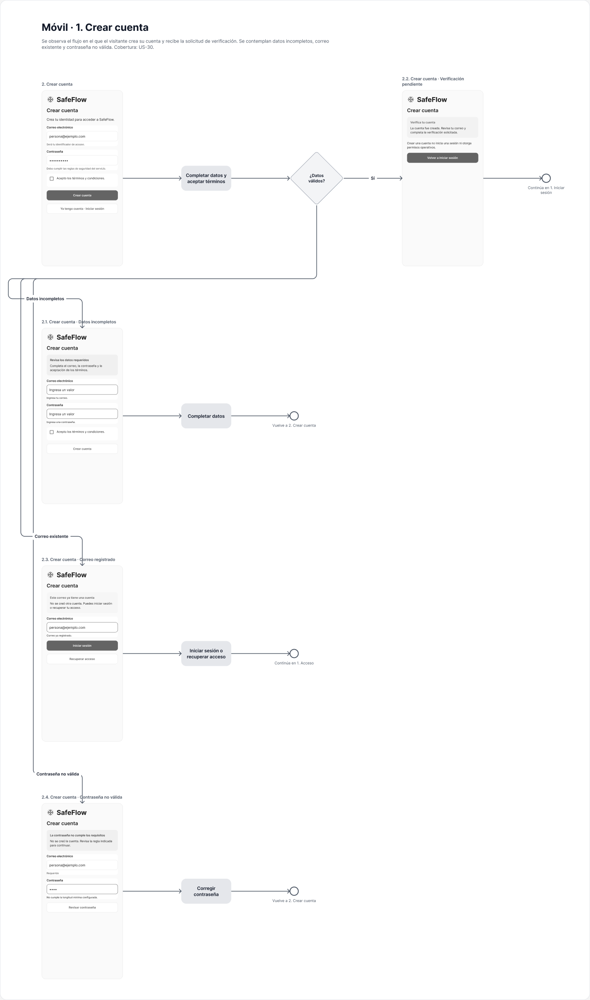

<strong><em>Nota.</em></strong> Página safeflow_wireflows de Figma. Flujo de Crear cuenta para el actor VISITANTE.

La Figura 79 corresponde al wireflow de Iniciar sesión (VISITANTE; cobertura de US-31).

<strong>Figura 79.</strong> <em>Wireflow Iniciar sesión</em>

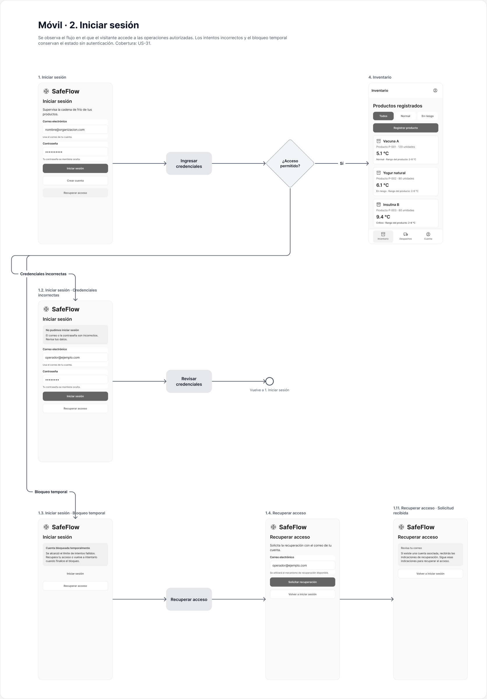

<strong><em>Nota.</em></strong> Página safeflow_wireflows de Figma. Flujo de Iniciar sesión para el actor VISITANTE.

La Figura 80 corresponde al wireflow de Productos e inventario (OPERADOR; cobertura de US-01 y US-10).

<strong>Figura 80.</strong> <em>Wireflow Productos e inventario</em>

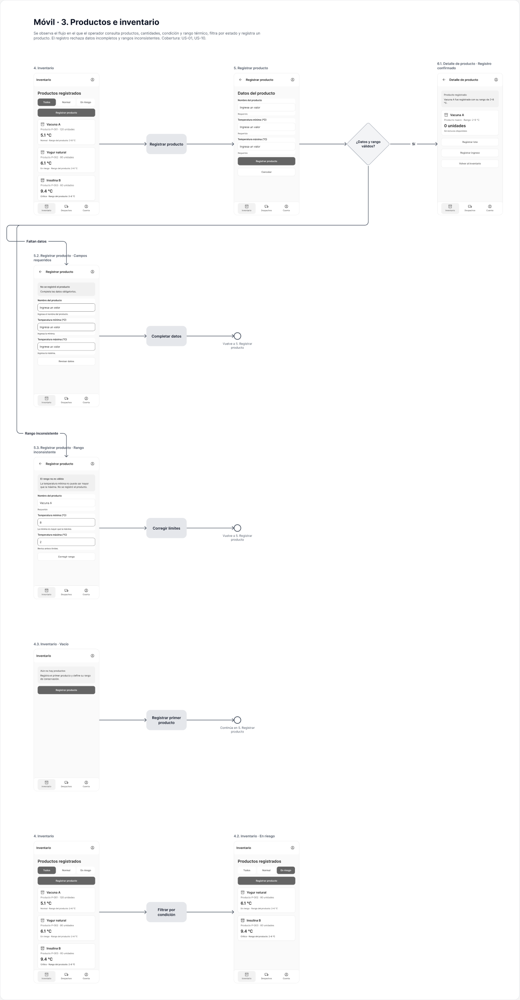

<strong><em>Nota.</em></strong> Página safeflow_wireflows de Figma. Flujo de Productos e inventario para el actor OPERADOR.

La Figura 81 corresponde al wireflow de Lotes (OPERADOR; cobertura de US-19).

<strong>Figura 81.</strong> <em>Wireflow Lotes</em>

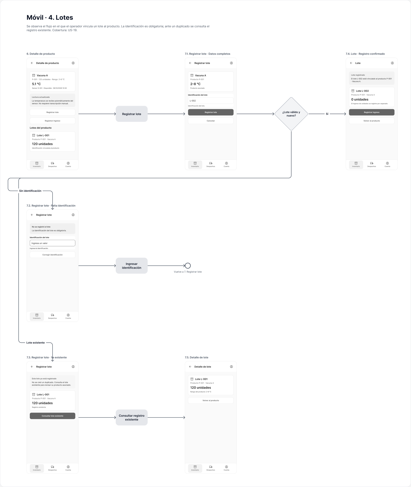

<strong><em>Nota.</em></strong> Página safeflow_wireflows de Figma. Flujo de Lotes para el actor OPERADOR.

La Figura 82 corresponde al wireflow de Ingresos de stock (OPERADOR; cobertura de US-02).

<strong>Figura 82.</strong> <em>Wireflow Ingresos de stock</em>

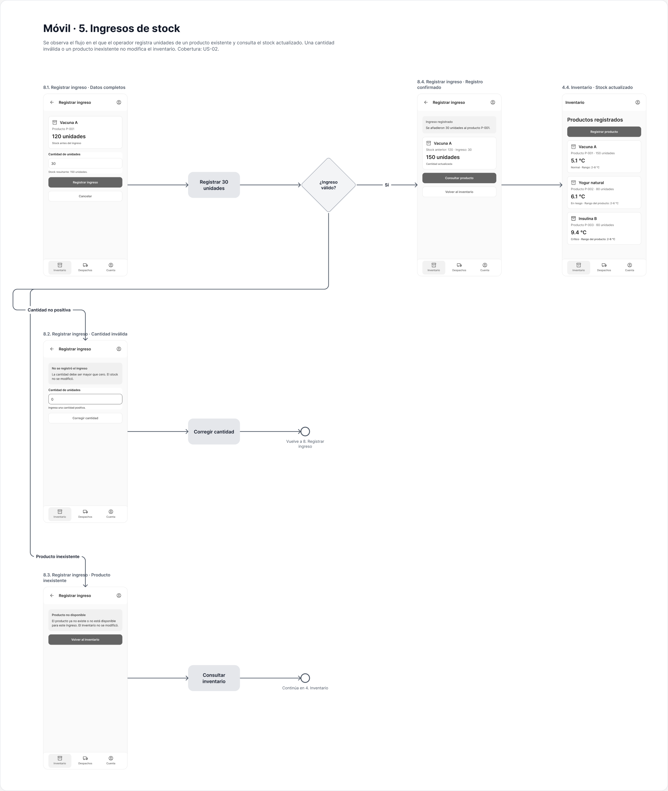

<strong><em>Nota.</em></strong> Página safeflow_wireflows de Figma. Flujo de Ingresos de stock para el actor OPERADOR.

La Figura 83 corresponde al wireflow de Monitoreo térmico (OPERADOR; cobertura de US-03 y US-52).

<strong>Figura 83.</strong> <em>Wireflow Monitoreo térmico</em>

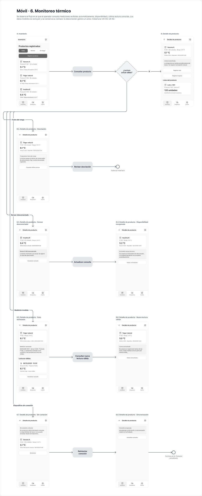

<strong><em>Nota.</em></strong> Página safeflow_wireflows de Figma. Flujo de Monitoreo térmico para el actor OPERADOR.

La Figura 84 corresponde al wireflow de Riesgos y anomalías (SUPERVISOR; cobertura de US-04 y US-20).

<strong>Figura 84.</strong> <em>Wireflow Riesgos y anomalías</em>

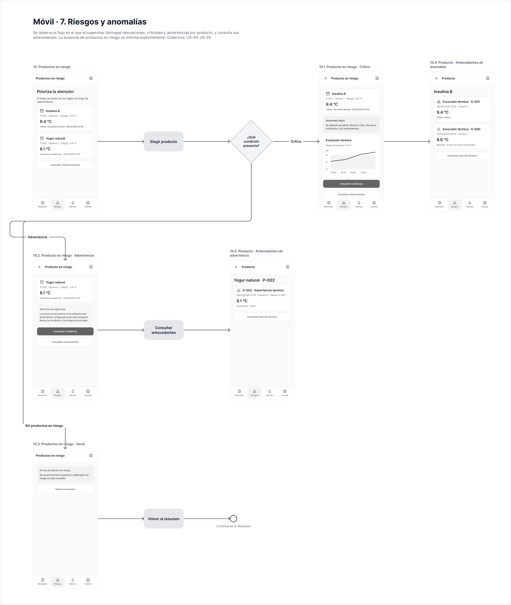

<strong><em>Nota.</em></strong> Página safeflow_wireflows de Figma. Flujo de Riesgos y anomalías para el actor SUPERVISOR.

La Figura 85 corresponde al wireflow de Historial térmico (SUPERVISOR; cobertura de US-17).

<strong>Figura 85.</strong> <em>Wireflow Historial térmico</em>

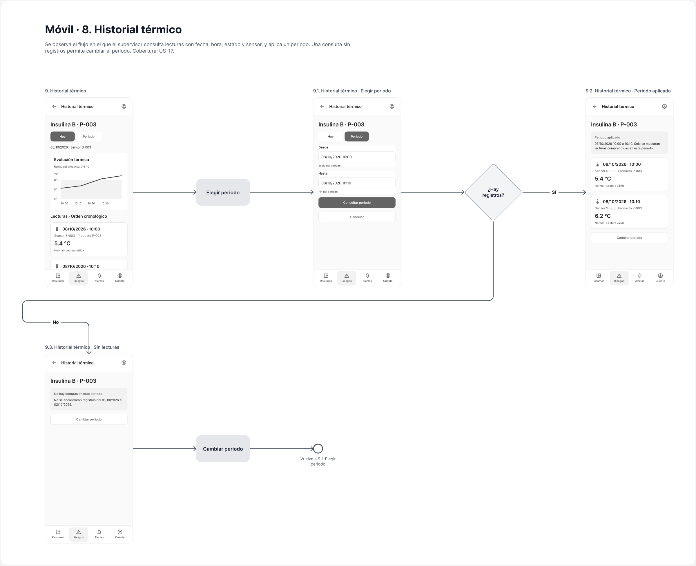

<strong><em>Nota.</em></strong> Página safeflow_wireflows de Figma. Flujo de Historial térmico para el actor SUPERVISOR.

La Figura 86 corresponde al wireflow de Alertas e incidencias (SUPERVISOR; cobertura de US-05, US-06 y US-55).

<strong>Figura 86.</strong> <em>Wireflow Alertas e incidencias</em>

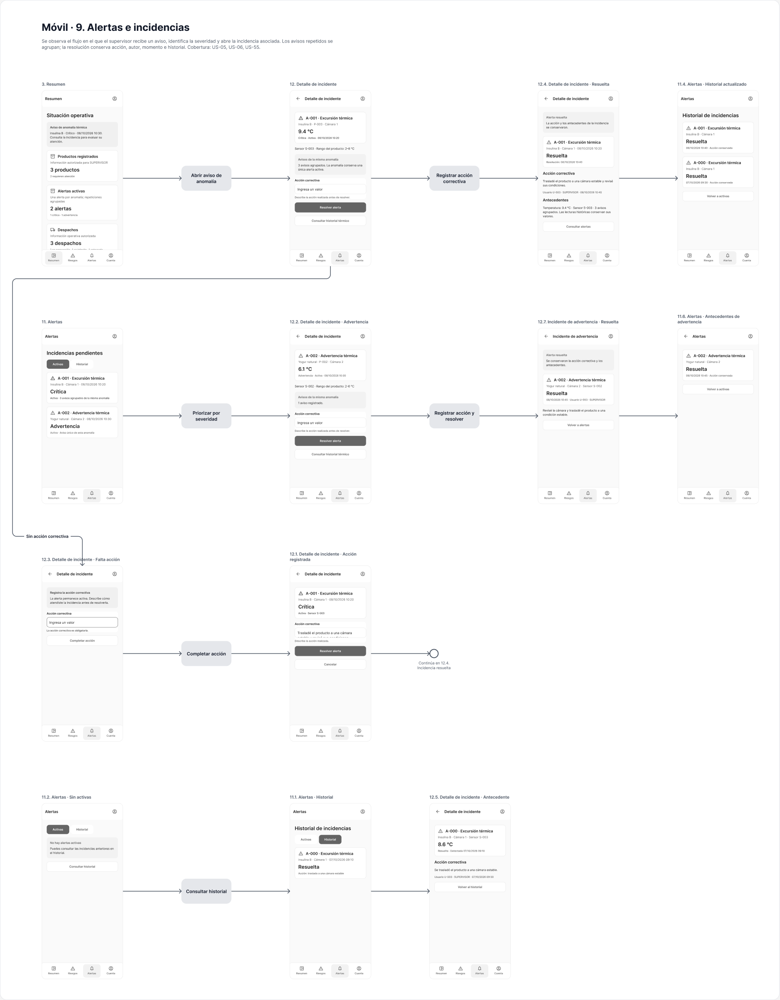

<strong><em>Nota.</em></strong> Página safeflow_wireflows de Figma. Flujo de Alertas e incidencias para el actor SUPERVISOR.

La Figura 87 corresponde al wireflow de Seguimiento de despachos (OPERADOR; cobertura de US-07 y US-25).

<strong>Figura 87.</strong> <em>Wireflow Seguimiento de despachos</em>

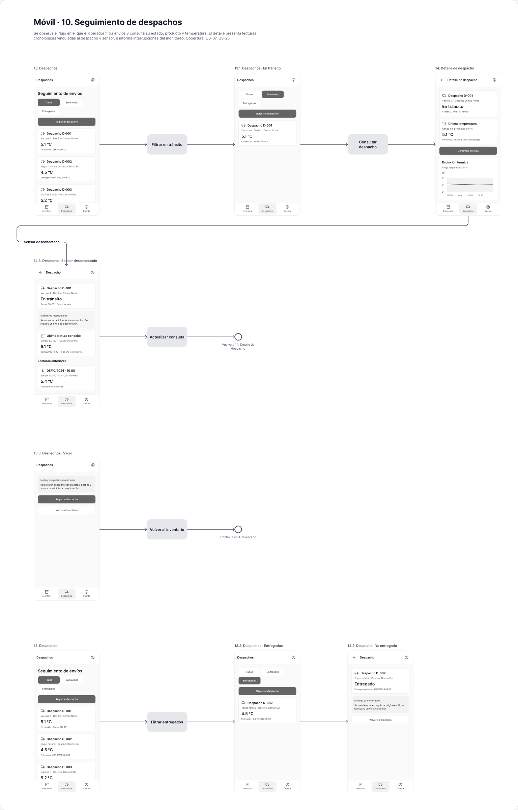

<strong><em>Nota.</em></strong> Página safeflow_wireflows de Figma. Flujo de Seguimiento de despachos para el actor OPERADOR.

La Figura 88 corresponde al wireflow de Confirmar entrega (OPERADOR; cobertura de US-24).

<strong>Figura 88.</strong> <em>Wireflow Confirmar entrega</em>

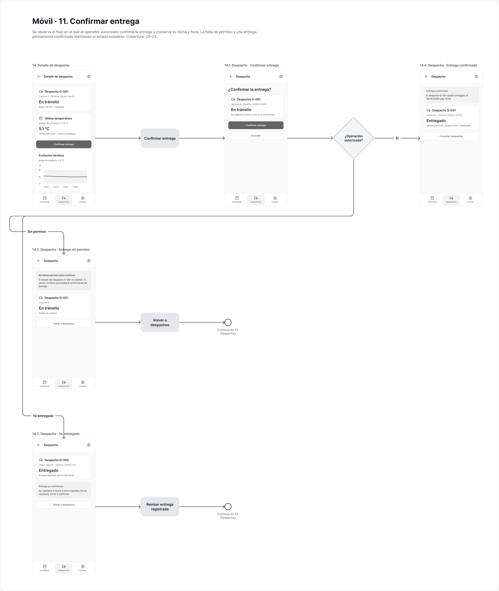

<strong><em>Nota.</em></strong> Página safeflow_wireflows de Figma. Flujo de Confirmar entrega para el actor OPERADOR.

La Figura 89 corresponde al wireflow de Validación previa al envío (OPERADOR; cobertura de US-47).

<strong>Figura 89.</strong> <em>Wireflow Validación previa al envío</em>

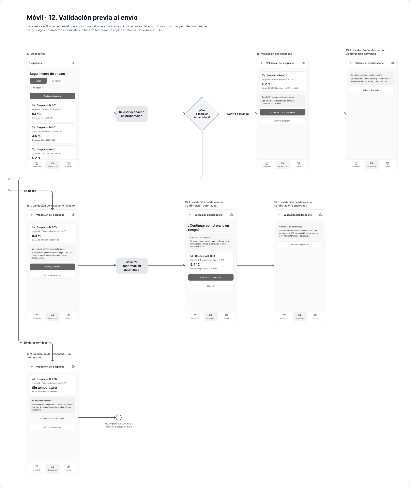

<strong><em>Nota.</em></strong> Página safeflow_wireflows de Figma. Flujo de Validación previa al envío para el actor OPERADOR.

La Figura 90 corresponde al wireflow de Resumen operativo (SUPERVISOR; cobertura de US-13).

<strong>Figura 90.</strong> <em>Wireflow Resumen operativo</em>

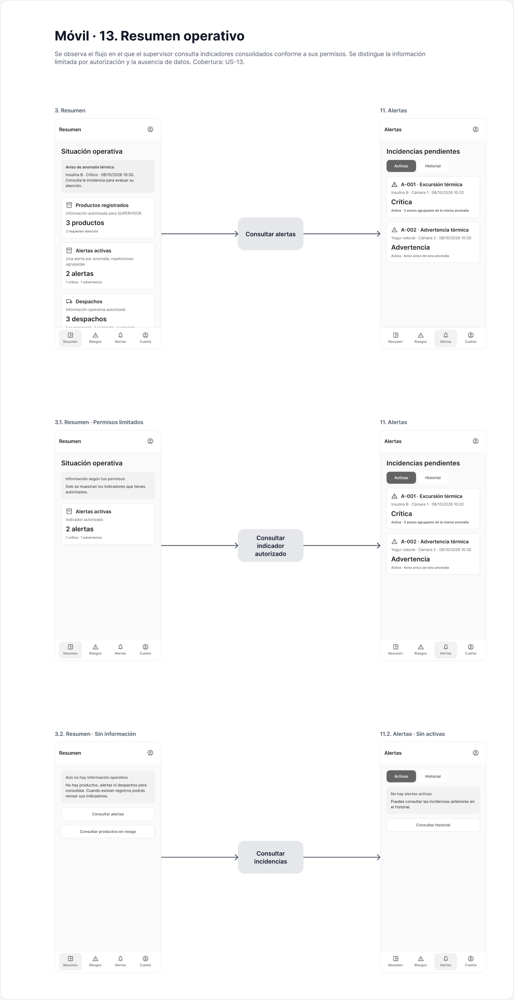

<strong><em>Nota.</em></strong> Página safeflow_wireflows de Figma. Flujo de Resumen operativo para el actor SUPERVISOR.

La Figura 91 corresponde al wireflow de Permisos por rol (ADMIN; cobertura de US-18).

<strong>Figura 91.</strong> <em>Wireflow Permisos por rol</em>

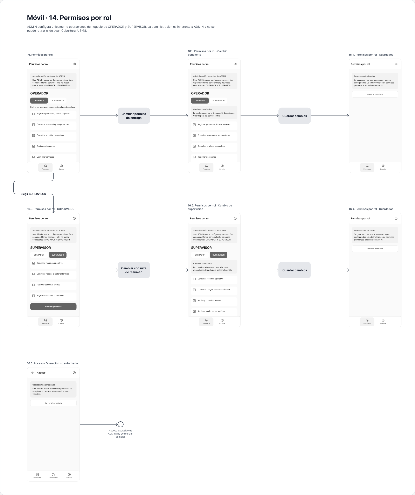

<strong><em>Nota.</em></strong> Página safeflow_wireflows de Figma. Flujo de Permisos por rol para el actor ADMIN.

La Figura 92 corresponde al wireflow de Cuenta y sesión compartida (USUARIO AUTENTICADO; cobertura de US-42).

<strong>Figura 92.</strong> <em>Wireflow Cuenta y sesión compartida</em>

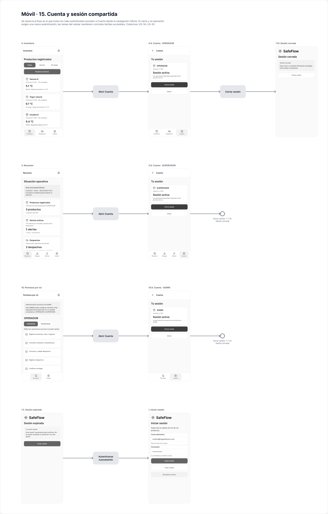

<strong><em>Nota.</em></strong> Página safeflow_wireflows de Figma. Flujo de Cuenta y sesión compartida para el actor USUARIO AUTENTICADO.

La Figura 93 corresponde al wireflow de Uso móvil en tableta (USUARIO AUTENTICADO; cobertura de US-34).

<strong>Figura 93.</strong> <em>Wireflow Uso móvil en tableta</em>

<strong><em>Nota.</em></strong> Página safeflow_wireflows de Figma. Flujo de Uso móvil en tableta para el actor USUARIO AUTENTICADO.

La Figura 94 corresponde al wireflow de Registrar despacho (OPERADOR; cobertura de US-61).

<strong>Figura 94.</strong> <em>Wireflow Registrar despacho</em>

<strong><em>Nota.</em></strong> Página safeflow_wireflows de Figma. Flujo de Registrar despacho para el actor OPERADOR.

#### 3.1.4.3. Mock-ups

Los mock-ups aplican el sistema visual de 3.1.1 a las 17 pantallas. A continuación se presentan 15 capturas representativas, agrupadas por actor, con las historias de usuario que cada una atiende. Todas se construyeron con instancias de componentes SafeFlow y con variables de color y tipografía, de modo que un cambio en el sistema se propaga a todas las pantallas. Los marcos reales de Figma incluyen para cada pantalla variantes de estado: datos completos, vacío (sin registros), error de validación y, donde aplica, estados de bloqueo o confirmación.

##### VISITANTE

El visitante aún no tiene sesión y solo accede a dos pantallas, con la marca y la frase de apoyo como encabezado.

La Figura 95 muestra la pantalla Iniciar sesión (US-31): correo y contraseña con texto de ayuda, el botón primario «Iniciar sesión», el secundario «Crear cuenta» y el tonal «Recuperar acceso». Sus estados cubren datos completos, credenciales incorrectas (error en el campo) y bloqueo temporal.

<strong>Figura 95.</strong> <em>Mock-up Iniciar sesión</em>

<strong><em>Nota.</em></strong> Marco de celular de la sección 01 VISITANTE en Figma.

La Figura 96 presenta Crear cuenta (US-30): correo, contraseña con la indicación de reglas de seguridad y casilla de aceptación de términos. Los estados incluyen correo ya existente y contraseña no admisible.

<strong>Figura 96.</strong> <em>Mock-up Crear cuenta</em>

<strong><em>Nota.</em></strong> Marco de celular de la sección 01 VISITANTE en Figma.

##### OPERADOR

El OPERADOR gestiona inventario y despachos con la barra inferior Inventario, Despachos y Cuenta.

La Figura 97 muestra Inventario (US-10): título «Productos registrados», chips Todos, Normal y En riesgo, el botón «Registrar producto» y tarjetas con nombre, código, unidades, temperatura actual y rango del producto. El color del icono y de la etiqueta (verde, ámbar y rojo) acompaña al texto de estado. Tiene estados con datos completos, inventario vacío y consulta por estado.

<strong>Figura 97.</strong> <em>Mock-up Inventario</em>

<strong><em>Nota.</em></strong> Marco de celular de la sección 03 OPERADOR en Figma.

La Figura 98 presenta Registrar producto (US-01), con nombre y rango de temperatura mínima y máxima, cada campo marcado como requerido. Sus estados incluyen datos incompletos y rango invertido.

<strong>Figura 98.</strong> <em>Mock-up Registrar producto</em>

<strong><em>Nota.</em></strong> Marco de celular de la sección 03 OPERADOR en Figma.

La Figura 99 muestra Detalle de producto (US-03 y US-10): temperatura actual, sensor, disponibilidad y hora, un aviso «Lectura actualizada» que indica que no se requiere transcripción manual, accesos a «Registrar lote» y «Registrar ingreso» y la lista de lotes. Sus estados incluyen sensor desconectado, sin lotes y excursión térmica.

<strong>Figura 99.</strong> <em>Mock-up Detalle de producto</em>

<strong><em>Nota.</em></strong> Marco de celular de la sección 03 OPERADOR en Figma.

La Figura 100 corresponde a Registrar lote (US-19): una tarjeta del producto asociado y el campo de identificación del lote. Sus estados incluyen identificación vacía y lote existente.

<strong>Figura 100.</strong> <em>Mock-up Registrar lote</em>

<strong><em>Nota.</em></strong> Marco de celular de la sección 03 OPERADOR en Figma.

La Figura 101 muestra Registrar ingreso (US-02): el stock antes del ingreso («120 unidades») y el campo de cantidad. Sus estados incluyen cantidad no positiva y producto inexistente.

<strong>Figura 101.</strong> <em>Mock-up Registrar ingreso</em>

<strong><em>Nota.</em></strong> Marco de celular de la sección 03 OPERADOR en Figma.

La Figura 102 presenta Despachos (US-25): chips Todos, En tránsito y Entregados, el botón «Registrar despacho» y tarjetas con producto, destino, temperatura, estado y sensor. Admite estados con datos completos, sin envíos y consulta por estado.

<strong>Figura 102.</strong> <em>Mock-up Despachos</em>

<strong><em>Nota.</em></strong> Marco de celular de la sección 03 OPERADOR en Figma.

La Figura 103 muestra Registrar despacho (US-61): selectores de producto y de sensor, campos de lote, cantidad y destino, y los botones de registro y cancelación. El despacho queda en preparación hasta validar su condición térmica. Sus estados incluyen datos incompletos, cantidad no válida y referencias inconsistentes.

<strong>Figura 103.</strong> <em>Mock-up Registrar despacho</em>

<strong><em>Nota.</em></strong> Marco de celular de la sección 03 OPERADOR en Figma.

La Figura 104 presenta Validación del despacho (US-47): el producto, su rango, la última temperatura y un aviso verde «Condición térmica dentro del rango» con el botón «Continuar con el despacho». Los demás estados cubren riesgo con confirmación autorizada y bloqueo por falta de datos, y desde allí la entrega se confirma (US-24).

<strong>Figura 104.</strong> <em>Mock-up Validación del despacho</em>

<strong><em>Nota.</em></strong> Marco de celular de la sección 03 OPERADOR en Figma.

##### SUPERVISOR

El SUPERVISOR evalúa la situación operativa con la barra Resumen, Riesgos, Alertas y Cuenta.

La Figura 105 muestra Resumen (US-13): un aviso crítico con la última anomalía y tarjetas de indicadores de productos, alertas activas y despachos. Tiene estados con datos, alcance por rol y ausencia de datos.

<strong>Figura 105.</strong> <em>Mock-up Resumen</em>

<strong><em>Nota.</em></strong> Marco de celular de la sección 04 SUPERVISOR en Figma.

La Figura 106 presenta Alertas (US-55 y US-05): chips Activas e Historial y tarjetas que distinguen la severidad (crítica y advertencia) e indican que se agrupan los avisos repetidos de una misma anomalía. Al abrir una alerta se llega al detalle de incidente, donde se registra la acción correctiva (US-06). Sus estados incluyen ausencia de alertas activas y alerta resuelta.

<strong>Figura 106.</strong> <em>Mock-up Alertas</em>

<strong><em>Nota.</em></strong> Marco de celular de la sección 04 SUPERVISOR en Figma.

La Figura 107 muestra Historial térmico (US-17): el gráfico de evolución con la banda del rango del producto sombreada y la lista de lecturas en orden cronológico, con filtros Hoy y Periodo. Sus estados incluyen historial completo, ausencia de registros y consulta por periodo.

<strong>Figura 107.</strong> <em>Mock-up Historial térmico</em>

<strong><em>Nota.</em></strong> Marco de celular de la sección 04 SUPERVISOR en Figma.

##### ADMIN

La Figura 108 presenta Permisos por rol (US-18): un aviso que declara que la administración de permisos es exclusiva de ADMIN y no puede concederse a OPERADOR ni a SUPERVISOR, un selector de rol y casillas con las operaciones permitidas. Sus estados incluyen cambios guardados y rechazo de cambios no autorizados.

<strong>Figura 108.</strong> <em>Mock-up Permisos por rol</em>

<strong><em>Nota.</em></strong> Marco de celular de la sección 05 ADMIN en Figma.

##### Versión de tableta

La Figura 109 muestra Inventario en tableta (US-34). La estructura es idéntica a la del celular; las tarjetas se distribuyen en dos columnas y la barra inferior se centra, para aprovechar el ancho sin cambiar el modelo mental del usuario. Las pantallas de tableta existen para los 17 destinos y sus estados.

<strong>Figura 109.</strong> <em>Mock-up Inventario en tableta</em>

<strong><em>Nota.</em></strong> Marco de tableta (768 x 1024 dp) de la sección 03 OPERADOR en Figma.

Como conjunto, los 15 mock-ups muestran que los tres roles comparten encabezado, tarjetas, chips y botones, y que la diferencia entre ellos está en los destinos y operaciones disponibles, no en el aspecto.

#### 3.1.4.4. User Flow Diagrams

Los flujos de usuario describen, para un objetivo concreto, la ruta esperada (happy path) y las rutas alternativas (unhappy paths) entre las pantallas diseñadas y los estados de sus marcos. Se presentan cuatro objetivos de usuario; los nodos de pantalla coinciden con los nombres de los mock-ups de 3.1.4.3.

**Objetivo 1: Registrar producto y lote (OPERADOR).** El OPERADOR quiere dejar un producto con su rango de temperatura y un lote asociado para que pueda monitorearse. Parte de Inventario, abre el formulario, y el sistema valida que el nombre exista y que el rango sea coherente (mínima menor que máxima). Si falla, permanece en el formulario con el error; si tiene éxito, se emite Producto registrado y puede registrar el lote desde el detalle, donde una identificación vacía o repetida produce error. La Figura 110 lo resume.

<strong>Figura 110.</strong> <em>User flow: Registrar producto y lote</em>

<strong><em>Nota.</em></strong> Elaboración propia a partir de los mock-ups Registrar producto, Detalle de producto y Registrar lote.

**Objetivo 2: Registrar despacho, validar la condición térmica y confirmar la entrega (OPERADOR).** El OPERADOR quiere enviar una carga con la seguridad de que su temperatura es admisible. Registra el despacho (queda en preparación), solicita la validación y la aplicación evalúa las mediciones del sensor: si están dentro del rango, se puede continuar con el envío; si hay riesgo, solo un usuario autorizado puede confirmar la continuación; si no hay datos, el envío se bloquea. Luego del envío, el OPERADOR confirma la entrega. La Figura 111 muestra el recorrido.

<strong>Figura 111.</strong> <em>User flow: Registrar despacho y confirmar entrega</em>

<strong><em>Nota.</em></strong> Elaboración propia. Los estados de condición térmica proceden de los marcos de Validación del despacho.

**Objetivo 3: Atender una alerta (SUPERVISOR).** El SUPERVISOR quiere resolver una incidencia térmica y dejar constancia. Recibe el aviso, abre Alertas, distingue la severidad y entra al detalle del incidente; allí registra la acción correctiva. Si no la completa, la alerta permanece activa; si la registra, queda resuelta y pasa al Historial. Si no hay alertas activas, se muestra un estado vacío. La Figura 112 describe el flujo.

<strong>Figura 112.</strong> <em>User flow: Atender una alerta</em>

<strong><em>Nota.</em></strong> Elaboración propia a partir de los mock-ups Alertas y Detalle de incidente.

**Objetivo 4: Iniciar sesión (VISITANTE).** El VISITANTE quiere acceder con su cuenta. Si las credenciales son correctas, pasa a USUARIO AUTENTICADO y entra al primer destino de su rol. Si fallan, se muestra el error; tras intentos fallidos repetidos, la cuenta queda bloqueada temporalmente. Más adelante, si la sesión se cierra o expira, vuelve a Iniciar sesión. La Figura 113 lo resume.

<strong>Figura 113.</strong> <em>User flow: Iniciar sesión, bloqueo temporal y sesión expirada</em>

<strong><em>Nota.</em></strong> Elaboración propia. Cubre los estados de credenciales incorrectas y bloqueo temporal y el cierre o expiración de la sesión.

Los cuatro flujos son consistentes con los wireflows de 3.1.4.2: cada nodo de pantalla existe como mock-up y cada ruta alternativa corresponde a un estado de error, vacío o bloqueo diseñado.

#### 3.1.4.5. Prototyping

El prototipo de Figma conecta los marcos de celular y tableta para simular la navegación real: la barra inferior cambia de destino según el rol, los chips filtran las listas, las tarjetas abren su detalle y los botones de registro llevan a sus formularios y de vuelta con su estado resultante. Las interacciones siguen las decisiones de arquitectura de información: navegación inferior por rol, navegación jerárquica con retorno y acceso a Cuenta desde el encabezado. El prototipo incluye los recorridos de los flujos de 3.1.4.4, entre ellos el despacho conectado hasta la entrega con sus errores de datos, cantidad y referencias, y se verificó que no existan enlaces rotos, taps sin destino ni escenarios inalcanzables desde sus puntos de partida. El prototipo está disponible en el archivo [SafeFlow](https://www.figma.com/design/ebf6YJVRmfKTHq2EDicpix/Safeflow).

**Video de demostración:** [Ver video de prueba](https://upcedupe-my.sharepoint.com/:v:/g/personal/u202123362_upc_edu_pe/IQBOGScGWfb5SLhtzpTS27uxAZd_MAZNwiqPsrOLz1ZA2YY?nav=eyJyZWZlcnJhbEluZm8iOnsicmVmZXJyYWxBcHAiOiJPbmVEcml2ZUZvckJ1c2luZXNzIiwicmVmZXJyYWxBcHBQbGF0Zm9ybSI6IldlYiIsInJlZmVycmFsTW9kZSI6InZpZXciLCJyZWZlcnJhbFZpZXciOiJNeUZpbGVzTGlua0NvcHkifX0&e=scIjL5)

