

         

<h3 align="center"> Universidad Peruana de Ciencias Aplicadas </h3>

<h3 align="center">Carrera de Ingeniería de Software </h3>

<h3 align="center">
    <b>
        1ACC0238 
    </b>    
</h3>

<h3 align="center"> 
    <b>
        Aplicaciones para Dispositivos Móviles
    </b>
</h3>
<h3 align="center"> NRC </h3>

<h3 align="center">  
    <b>
        3690
    </b>
</h3>

<h3 align="center"> 
    <b>
        Informe de Trabajo Final
    </b>
</h3>

<h3 align="center"> Docente</h3>
<h3 align="center"> 
    <b>
        Mayta Guillermo, Jorge Luis 
    </b>
</h3>

<h3 align="center"> Equipo </h3>
<h3 align="center">  
    <b>
        Cryologic System
    </b>
</h3>

<h3 align="center"> Proyecto</h3>
<h3 align="center">  
    <b>
        SafeFlow
    </b>
</h3>

 

<h3 align="center">  
    <b>
        Integrantes
    </b>
</h3>

 
| Code       |      Member |
| :---:      |     :--- |
| U202218531 | Andy Alejandro Mio Mejia |
| U********* | --------- |
| U********* | --------- |
| U********* | --------- |
| U********* | --------- |

<h3 align="center">
    <b>
        Periodo 202620
    </b>
</h3>
<h3 align="center">
    <b>
        Julio 2026
    </b>
</h3>

## Registro de Versiones del Informe

    
| Versión |   Fecha    |                Autor                |                                                  Descripción de modificación                                                   |
|:-------:|:----------:|:-----------------------------------:|:------------------------------------------------------------------------------------------------------------------------------:|
|   AV1   | 12-09-2026 |   Mio Mejia, Andy Alejandro   |                                                   Descripción de la Startup                                                    |
|   AV1   | 12-09-2026 |   Mio Mejia, Andy Alejandro    |                                               Creación de la carpeta de Imagenes                                               |
|   AV1   | 12-09-2026 |   Mio Mejia, Andy Alejandro    |                                             Creacion de Ramas en los Repositorios                                              |                                              |
|   AV1   | 12-09-2026 |   Mio Mejia, Andy Alejandro    |                                                    Source Code Management.                                                     |              

## Project Report Collaboration Insights

A lo largo del desarrollo del trabajo, se ha evidenciado una participación activa, coordinada y progresiva por parte de todos los integrantes del equipo. Cada fase fue abordada de manera estructurada, siguiendo las buenas prácticas de trabajo colaborativo con control de versiones en GitHub, planificación por entregables, y asignación clara de responsabilidades según las competencias de cada integrante.

El uso de repositorios específicos por subcomponente también contribuyó a mantener una mejor trazabilidad del trabajo colaborativo, integrando ramas por entregables y controlando versiones según el avance de cada sprint.

A continuación, se detallan los repositorios utilizados a lo largo del proyecto:

#### Link del Repositorio del Reporte: [Repositorio del Informe](https://github.com/upc-pre-202620-1acc0238-4950-cryologic/safeflow-report.git)
#### Link del Repositorio de la Landing Page:  [Repositorio del Landing]()
#### Link del Repositorio del Frontend:  [Repositorio del Frontend]()
#### Link del Repositorio del Backend:  [Repositorio del Backend]()

A continuación, se detallan los Link de lo Desarrollado:

#### Link de la Landing Page:  [Link de la Landing Page]()
#### Link de la Plataforma Web:  [Link de la App Web]()

   

| Integrante | Tareas Asignadas                                                                                                                                                                                             |
|------------|------------------------------------------------------------------------------------------------------------------------------------------------------------------------------------------------------------------------------------------------------------------------------------------------------------------------------------------------------------------------------------------------------------------------------------------------------------------------------------------------------------------------------------------------------------------------------------------------------------------------------------------------------------------------------------------------------------------------------------------------------------------------------------------------------------------------------------------------------------------------------------------------------------------------------------------------------------------------------------------------------------------------------------|
| Andy Alejandro Mio Mejia | ****************** |
|  ******************  | ******************                                                                                                                                                                                                                                                                                                                                                                                                                                                                                    |
| ****************** | ****************** |
| ******************    | ******************                                                                                                                                                                                                                                   |
| ******************    | ******************                                                                                                       |

El proceso de colaboración en el informe se realizó mediante commits constantes al repositorio de la organización.

## **Github Collaboration Insights**

Los integrantes son:

* Andy Alejandro Mio Mejia   (AndyMio17)
* ******************   (********)
* ****************** (********)
* ****************** (********)
* ****************** (********)

   

### Github Collaboration  Informe

  
        

### Github Collaboration  Landing

  
        

### Github Collaboration  Frontend

  
        

### Github Collaboration  Backend

  
        

# Contenido

## Tabla de Contenidos

[Registro de versiones del informe](#registro-de-versiones-del-informe)

[Project Report Collaboration Insights](#project-report-collaboration-insights)

[Contenido](#contenido)

[Student Outcome](#student-outcome)

[Capítulo I: Presentación](#capitulo-i-introduccion)

- [1.1. Startup Profile](#11-startup-profile)
  - [1.1.1. Descripción de la Startup](#111-descripción-de-la-startup)
  - [1.1.2. Perfiles de integrantes del equipo](#112-perfiles-de-integrantes-del-equipo)
- [1.2. Solution Profile](#12-solution-profile)
  - [1.2.1. Antecedentes y problemática](#121-antecedentes-y-problemática)
  - [1.2.2. Lean UX Process](#122-lean-ux-process)
    - [1.2.2.1. Lean UX Problem Statements](#1221-lean-ux-problem-statements)
    - [1.2.2.2. Lean UX Assumptions](#1222-lean-ux-assumptions)
    - [1.2.2.3. Lean UX Hypothesis Statements](#1223-lean-ux-hypothesis-statements)
    - [1.2.2.4. Lean UX Canvas](#1224-lean-ux-canvas)
- [1.3. Segmentos objetivo](#13-segmentos-objetivo)

[Capítulo II: Requirements Elicitation & Analysis](#capítulo-ii-requirements-elicitation--analysis-1)

- [2.1. Competidores](#21-competidores)
  - [2.1.1. Análisis competitivo](#211-análisis-competitivo)
  - [2.1.2. Estrategias y tácticas frente a competidores](#212-estrategias-y-tácticas-frente-a-competidores)
- [2.2. Entrevistas](#22-entrevistas)
  - [2.2.1. Diseño de entrevistas](#221-diseño-de-entrevistas)
  - [2.2.2. Registro de entrevistas](#222-registro-de-entrevistas)
  - [2.2.3. Análisis de entrevistas](#223-análisis-de-entrevistas)
- [2.3. Needfinding](#23-needfinding)
  - [2.3.1. User Personas](#231-user-personas)
  - [2.3.2. User Task Matrix](#232-user-task-matrix)
  - [2.3.3. User Journey Mapping](#233-user-journey-mapping)
  - [2.3.4. Empathy Mapping](#234-empathy-mapping)
  - [2.3.5. Big Picture EventStorming](#235-big-picture-eventstorming)
  - [2.3.6. Ubiquitous Language](#236-ubiquitous-language)

- [2.4. Requirements specification](#24-requirements-specification)
  - [2.4.1. User Stories](#241-user-stories)
  - [2.4.2. Impact Mapping ](#242-impact-mapping)
  - [2.4.3. Product Backlog](#243-product-backlog)

- [2.5. Strategic-Level Domain-Driven Design](#25-strategic-level-domain-driven-design)
  - [2.5.1. EventStorming](#251-eventstorming)
    - [2.5.1.1. Candidate Context Discovery](#2511-candidate-context-discovery)
    - [2.5.1.2. Domain Message Flows Modeling](#2512-domain-message-flows-modeling)
    - [2.5.1.3. Context Canvases](#2513-context-canvases)
  - [2.5.2. Context Mapping](#252-context-mapping)
  - [2.5.3. Software Architecture](#253-software-architecture)
    - [2.5.3.1. Software Architecture Context Level Diagrams](#2531-software-architecture-context-level-diagrams)
    - [2.5.3.2. Software Architecture Container Level Diagrams](#2532-software-architecture-container-level-diagrams)
    - [2.5.3.3. Software Architecture Deployment Diagrams](#2533-software-architecture-deployment-diagrams)
  
- [2.6. Tactical-Level Domain-Driven Design](#26-tactical-level-domain-driven-design)
  - [2.6.1. Bounded Context: iam](#261-bounded-context-iam)
    - [2.6.1.1. Domain Layer](#2611-domain-layer)
    - [2.6.1.2. Interface Layer](#2612-interface-layer)
    - [2.6.1.3. Application Layer](#2613-application-layer)
    - [2.6.1.4. Infrastructure Layer](#2614-infrastructure-layer)
    - [2.6.1.5. Bounded Context Software Architecture Component Level Diagrams](#2615-bounded-context-software-architecture-component-level-diagrams)
    - [2.6.1.6. Bounded Context Software Architecture Code Level Diagrams](#2616-bounded-context-software-architecture-code-level-diagrams)
      - [2.6.1.6.1. Bounded Context Domain Layer Class Diagrams](#26161-bounded-context-domain-layer-class-diagrams)
      - [2.6.1.6.2. Bounded Context Database Design Diagram](#26162-bounded-context-database-design-diagram)
  
  - [2.6.2. Bounded Context: alerts](#262-bounded-context-alerts)
    - [2.6.2.1. Domain Layer](#2621-domain-layer)
    - [2.6.2.2. Interface Layer](#2622-interface-layer)
    - [2.6.2.3. Application Layer](#2623-application-layer)
    - [2.6.2.4. Infrastructure Layer](#2624-infrastructure-layer)
    - [2.6.2.5. Bounded Context Software Architecture Component Level Diagrams](#2625-bounded-context-software-architecture-component-level-diagrams)
    - [2.6.2.6. Bounded Context Software Architecture Code Level Diagrams](#2626-bounded-context-software-architecture-code-level-diagrams)
      - [2.6.2.6.1. Bounded Context Domain Layer Class Diagrams](#26261-bounded-context-domain-layer-class-diagrams)
      - [2.6.2.6.2. Bounded Context Database Design Diagram](#26262-bounded-context-database-design-diagram)

  - [2.6.3. Bounded Context: analytics](#263-bounded-context-analytics)
    - [2.6.3.1. Domain Layer](#2631-domain-layer)
    - [2.6.3.2. Interface Layer](#2632-interface-layer)
    - [2.6.3.3. Application Layer](#2633-application-layer)
    - [2.6.3.4. Infrastructure Layer](#2634-infrastructure-layer)
    - [2.6.3.5. Bounded Context Software Architecture Component Level Diagrams](#2635-bounded-context-software-architecture-component-level-diagrams)
    - [2.6.3.6. Bounded Context Software Architecture Code Level Diagrams](#2636-bounded-context-software-architecture-code-level-diagrams)
      - [2.6.3.6.1. Bounded Context Domain Layer Class Diagrams](#26361-bounded-context-domain-layer-class-diagrams)
      - [2.6.3.6.2. Bounded Context Database Design Diagram](#26362-bounded-context-database-design-diagram)

  - [2.6.4. Bounded Context: environmental-monitoring](#264-bounded-context-environmental-monitoring)
    - [2.6.4.1. Domain Layer](#2641-domain-layer)
    - [2.6.4.2. Interface Layer](#2642-interface-layer)
    - [2.6.4.3. Application Layer](#2643-application-layer)
    - [2.6.4.4. Infrastructure Layer](#2644-infrastructure-layer)
    - [2.6.4.5. Bounded Context Software Architecture Component Level Diagrams](#2645-bounded-context-software-architecture-component-level-diagrams)
    - [2.6.4.6. Bounded Context Software Architecture Code Level Diagrams](#2646-bounded-context-software-architecture-code-level-diagrams)
      - [2.6.4.6.1. Bounded Context Domain Layer Class Diagrams](#26461-bounded-context-domain-layer-class-diagrams)
      - [2.6.4.6.2. Bounded Context Database Design Diagram](#26462-bounded-context-database-design-diagram)

  - [2.6.5. Bounded Context: inventory](#265-bounded-context-inventory)
    - [2.6.5.1. Domain Layer](#2651-domain-layer)
    - [2.6.5.2. Interface Layer](#2652-interface-layer)
    - [2.6.5.3. Application Layer](#2653-application-layer)
    - [2.6.5.4. Infrastructure Layer](#2654-infrastructure-layer)
    - [2.6.5.5. Bounded Context Software Architecture Component Level Diagrams](#2655-bounded-context-software-architecture-component-level-diagrams)
    - [2.6.5.6. Bounded Context Software Architecture Code Level Diagrams](#2656-bounded-context-software-architecture-code-level-diagrams)
      - [2.6.5.6.1. Bounded Context Domain Layer Class Diagrams](#26561-bounded-context-domain-layer-class-diagrams)
      - [2.6.5.6.2. Bounded Context Database Design Diagram](#26562-bounded-context-database-design-diagram)
  
  - [2.6.6. Bounded Context: logistics](#266-bounded-context-logistics)
    - [2.6.6.1. Domain Layer](#2661-domain-layer)
    - [2.6.6.2. Interface Layer](#2662-interface-layer)
    - [2.6.6.3. Application Layer](#2663-application-layer)
    - [2.6.6.4. Infrastructure Layer](#2664-infrastructure-layer)
    - [2.6.6.5. Bounded Context Software Architecture Component Level Diagrams](#2665-bounded-context-software-architecture-component-level-diagrams)
    - [2.6.6.6. Bounded Context Software Architecture Code Level Diagrams](#2666-bounded-context-software-architecture-code-level-diagrams)
      - [2.6.6.6.1. Bounded Context Domain Layer Class Diagrams](#26661-bounded-context-domain-layer-class-diagrams)
      - [2.6.6.6.2. Bounded Context Database Design Diagram](#26662-bounded-context-database-design-diagram)
  - [2.6.7. Bounded Context: reporting](#267-bounded-context-reporting)
    - [2.6.7.1. Domain Layer](#2671-domain-layer)
    - [2.6.7.2. Interface Layer](#2672-interface-layer)
    - [2.6.7.3. Application Layer](#2673-application-layer)
    - [2.6.7.4. Infrastructure Layer](#2674-infrastructure-layer)
    - [2.6.7.5. Bounded Context Software Architecture Component Level Diagrams](#2675-bounded-context-software-architecture-component-level-diagrams)
    - [2.6.7.6. Bounded Context Software Architecture Code Level Diagrams](#2676-bounded-context-software-architecture-code-level-diagrams)
      - [2.6.7.6.1. Bounded Context Domain Layer Class Diagrams](#26761-bounded-context-domain-layer-class-diagrams)
      - [2.6.7.6.2. Bounded Context Database Design Diagram](#26762-bounded-context-database-design-diagram)

 
Capítulo III: Solution UI/UX Design 
3.1. Product design 
3.1.1. Style Guidelines 
3.1.1.1. General Style Guidelines 
3.1.2. Information Architecture 
3.1.2.1. Organization Systems 
3.1.2.2. Labelling Systems 
3.1.2.3. SEO Tags and Meta Tags 
3.1.2.4. Searching Systems 
3.1.2.5. Navigation Systems 
3.1.3. Landing Page UI Design 
3.1.3.1. Landing Page Wireframe 
3.1.3.2. Landing Page Mock-up 
3.1.4. Mobile Applications UX/UI Design 
3.1.4.1. Mobile Applications Wireframes
3.1.4.2. Mobile Applications Wireflow Diagrams 
3.1.4.3. Mobile Applications Mock-ups 
3.1.4.4. Mobile Applications User Flow Diagrams 
3.1.4.5. Mobile Applications Prototyping 

Capítulo IV: Product Implementation & Validation 
4. Product Implementation & Validation 
4.1. Software Configuration Management 
4.1.1. Software Development Environment Configuration 
4.1.2. Source Code Management 
4.1.3. Source Code Style Guide & Conventions 
4.1.4. Software Deployment Configuration 
4.2. Landing Page & Mobile Application Implementation 
4.2.1. Sprint n 
4.2.1.1. Sprint Planning n 
4.2.1.2. Aspect Leaders and Collaborators 
4.2.1.3. Sprint Backlog n 
4.2.1.4. Development Evidence for Sprint Review
4.2.1.5. Testing Suite Evidence for Sprint Review 
4.2.1.6. Execution Evidence for Sprint Review 
4.2.1.7. Services Documentation Evidence for Sprint Review 
4.2.1.8. Software Deployment Evidence for Sprint Review
4.2.1.9. Team Collaboration Insights during Sprint
4.3. Validation Interviews 
4.3.1. Diseño de Entrevistas 
4.3.2. Registro de Entrevistas 
4.3.3. Evaluaciones según heurísticas

Conclusiones 
Conclusiones y recomendaciones. 
Video App Validation 
Video About the product 
Video About the team 
Glosario 
Bibliografía 
Anexos
 -->

[Capítulo III: Solution UI/UX Design](#capítulo-iii-solution-uiux-design)

- [3.1. Product Design](#31-product-design)
  - [3.1.1. Style Guidelines](#311-style-guidelines)
    - [3.1.1.1. General Style Guidelines](#3111-general-style-guidelines)
  - [3.1.2. Information Architecture](#312-information-architecture)
    - [3.1.2.1. Organization Systems](#3121-organization-systems)
    - [3.1.2.2. Labelling Systems](#3122-labelling-systems)
    - [3.1.2.3. SEO Tags and Meta Tags](#3123-seo-tags-and-meta-tags)
    - [3.1.2.4. Searching Systems](#3124-searching-systems)
    - [3.1.2.5. Navigation Systems](#3125-navigation-systems)
  - [3.1.3. Landing Page UI Design](#313-landing-page-ui-design)
    - [3.1.3.1. Landing Page Wireframe](#3131-landing-page-wireframe)
    - [3.1.3.2. Landing Page Mock-up](#3132-landing-page-mock-up)
  - [3.1.4. Mobile Applications UX/UI Design](#314-mobile-applications-uxui-design)
    - [3.1.4.1. Mobile Applications Wireframes](#3141-mobile-applications-wireframes)
    - [3.1.4.2. Mobile Applications Wireflow Diagrams](#3142-mobile-applications-wireflow-diagrams)
    - [3.1.4.3. Mobile Applications Mock-ups](#3143-mobile-applications-mock-ups)
    - [3.1.4.4. Mobile Applications User Flow Diagrams](#3144-mobile-applications-user-flow-diagrams)
    - [3.1.4.5. Mobile Applications Prototyping](#3145-mobile-applications-prototyping)

[Capítulo IV: Product Implementation & Validation](#capítulo-iv-product-implementation-validation)

- [4. Product Implementation & Validation](#4-product-implementation-validation)
  - [4.1. Software Configuration Management](#41-software-configuration-management)
    - [4.1.1. Software Development Environment Configuration](#411-software-development-environment-configuration)
    - [4.1.2. Source Code Management](#412-source-code-management)
    - [4.1.3. Source Code Style Guide & Conventions](#413-source-code-style-guide--conventions)
    - [4.1.4. Software Deployment Configuration](#414-software-deployment-configuration)
  - [4.2. Landing Page & Mobile Application Implementation](#42-landing-page--mobile-application-implementation)
    - [4.2.1. Sprint n](#421-sprint-n)
      - [4.2.1.1. Sprint Planning n](#4211-sprint-planning-n)
      - [4.2.1.2. Aspect Leaders and Collaborators](#4212-aspect-leaders-and-collaborators)
      - [4.2.1.3. Sprint Backlog n](#4213-sprint-backlog-n)
      - [4.2.1.4. Development Evidence for Sprint Review](#4214-development-evidence-for-sprint-review)
      - [4.2.1.5. Testing Suite Evidence for Sprint Review](#4215-testing-suite-evidence-for-sprint-review)
      - [4.2.1.6. Execution Evidence for Sprint Review](#4216-execution-evidence-for-sprint-review)
      - [4.2.1.7. Services Documentation Evidence for Sprint Review](#4217-services-documentation-evidence-for-sprint-review)
      - [4.2.1.8. Software Deployment Evidence for Sprint Review](#4218-software-deployment-evidence-for-sprint-review)
      - [4.2.1.9. Team Collaboration Insights during Sprint](#4219-team-collaboration-insights-during-sprint)
  - [4.3. Validation Interviews](#43-validation-interviews)
    - [4.3.1. Diseño de Entrevistas](#431-diseño-de-entrevistas)
    - [4.3.2. Registro de Entrevistas](#432-registro-de-entrevistas)
    - [4.3.3. Evaluaciones según heurísticas](#433-evaluaciones-según-heurísticas)

[Conclusiones y recomendaciones](#conclusiones-y-recomendaciones)

[Video App Validation](#video-app-validation)

[Video About the product](#video-about-the-product)

[Video About the team](#video-about-the-team)

[Glosario](#glosario)

[Bibliografía](#bibliografía)

[Anexos](#anexos)

# Student Outcome

A continuación, cada integrante del equipo detallará su contribución al proyecto en base a los criterios del Student Outcome (Trabajo en equipo, liderazgo, entorno colaborativo y cumplimiento de metas).

### 1. Integrante 1
* **Criterio específico:** [Por completar]
* **Acciones realizadas:** 
  * [Por completar]
* **Conclusiones:** [Por completar]

### 2. Integrante 2
* **Criterio específico:** [Por completar]
* **Acciones realizadas:** 
  * [Por completar]
* **Conclusiones:** [Por completar]

### 3. Integrante 3
* **Criterio específico:** [Por completar]
* **Acciones realizadas:** 
  * [Por completar]
* **Conclusiones:** [Por completar]

### 4. Integrante 4
* **Criterio específico:** [Por completar]
* **Acciones realizadas:** 
  * [Por completar]
* **Conclusiones:** [Por completar]

### 5. Integrante 5
* **Criterio específico:** [Por completar]
* **Acciones realizadas:** 
  * [Por completar]
* **Conclusiones:** [Por completar]

# Capítulo I: Presentación

## 1.1. Startup Profile

### 1.1.1. Descripción de la Startup

### 1.1.2. Perfiles de integrantes del equipo

## 1.2. Solution Profile

### 1.2.1. Antecedentes y problemática

### 1.2.2. Lean UX Process

#### 1.2.2.1. Lean UX Problem Statements

#### 1.2.2.2. Lean UX Assumptions

#### 1.2.2.3. Lean UX Hypothesis Statements

#### 1.2.2.4. Lean UX Canvas

## 1.3. Segmentos objetivo

# Capítulo II: Requirements Elicitation & Analysis

## 2.1. Competidores

### 2.1.1. Análisis competitivo

### 2.1.2. Estrategias y tácticas frente a competidores

## 2.2. Entrevistas

### 2.2.1. Diseño de entrevistas

### 2.2.2. Registro de entrevistas

### 2.2.3. Análisis de entrevistas

## 2.3. Needfinding

### 2.3.1. User Personas

### 2.3.2. User Task Matrix

### 2.3.3. User Journey Mapping

### 2.3.4. Empathy Mapping

### 2.3.5. Big Picture EventStorming

### 2.3.6. Ubiquitous Language

## 2.4. Requirements specification

### 2.4.1. User Stories

### 2.4.2. Impact Mapping 

### 2.4.3. Product Backlog

## 2.5. Strategic-Level Domain-Driven Design

### 2.5.1. EventStorming

#### 2.5.1.1. Candidate Context Discovery

#### 2.5.1.2. Domain Message Flows Modeling

#### 2.5.1.3. Context Canvases

### 2.5.2. Context Mapping

### 2.5.3. Software Architecture

#### 2.5.3.1. Software Architecture Context Level Diagrams

#### 2.5.3.2. Software Architecture Container Level Diagrams

#### 2.5.3.3. Software Architecture Deployment Diagrams

## 2.6. Tactical-Level Domain-Driven Design

### 2.6.1. Bounded Context: iam

#### 2.6.1.1. Domain Layer

#### 2.6.1.2. Interface Layer

#### 2.6.1.3. Application Layer

#### 2.6.1.4. Infrastructure Layer

#### 2.6.1.5. Bounded Context Software Architecture Component Level Diagrams

#### 2.6.1.6. Bounded Context Software Architecture Code Level Diagrams

##### 2.6.1.6.1. Bounded Context Domain Layer Class Diagrams

##### 2.6.1.6.2. Bounded Context Database Design Diagram

### 2.6.2. Bounded Context: alerts

#### 2.6.2.1. Domain Layer

#### 2.6.2.2. Interface Layer

#### 2.6.2.3. Application Layer

#### 2.6.2.4. Infrastructure Layer

#### 2.6.2.5. Bounded Context Software Architecture Component Level Diagrams

#### 2.6.2.6. Bounded Context Software Architecture Code Level Diagrams

##### 2.6.2.6.1. Bounded Context Domain Layer Class Diagrams

##### 2.6.2.6.2. Bounded Context Database Design Diagram

### 2.6.3. Bounded Context: analytics

#### 2.6.3.1. Domain Layer

#### 2.6.3.2. Interface Layer

#### 2.6.3.3. Application Layer

#### 2.6.3.4. Infrastructure Layer

#### 2.6.3.5. Bounded Context Software Architecture Component Level Diagrams

#### 2.6.3.6. Bounded Context Software Architecture Code Level Diagrams

##### 2.6.3.6.1. Bounded Context Domain Layer Class Diagrams

##### 2.6.3.6.2. Bounded Context Database Design Diagram

### 2.6.4. Bounded Context: environmental-monitoring

#### 2.6.4.1. Domain Layer

#### 2.6.4.2. Interface Layer

#### 2.6.4.3. Application Layer

#### 2.6.4.4. Infrastructure Layer

#### 2.6.4.5. Bounded Context Software Architecture Component Level Diagrams

#### 2.6.4.6. Bounded Context Software Architecture Code Level Diagrams

##### 2.6.4.6.1. Bounded Context Domain Layer Class Diagrams

##### 2.6.4.6.2. Bounded Context Database Design Diagram

### 2.6.5. Bounded Context: inventory

#### 2.6.5.1. Domain Layer

#### 2.6.5.2. Interface Layer

#### 2.6.5.3. Application Layer

#### 2.6.5.4. Infrastructure Layer

#### 2.6.5.5. Bounded Context Software Architecture Component Level Diagrams

#### 2.6.5.6. Bounded Context Software Architecture Code Level Diagrams

##### 2.6.5.6.1. Bounded Context Domain Layer Class Diagrams

##### 2.6.5.6.2. Bounded Context Database Design Diagram

### 2.6.6. Bounded Context: logistics

#### 2.6.6.1. Domain Layer

#### 2.6.6.2. Interface Layer

#### 2.6.6.3. Application Layer

#### 2.6.6.4. Infrastructure Layer

#### 2.6.6.5. Bounded Context Software Architecture Component Level Diagrams

#### 2.6.6.6. Bounded Context Software Architecture Code Level Diagrams

##### 2.6.6.6.1. Bounded Context Domain Layer Class Diagrams

##### 2.6.6.6.2. Bounded Context Database Design Diagram

### 2.6.7. Bounded Context: reporting

#### 2.6.7.1. Domain Layer

#### 2.6.7.2. Interface Layer

#### 2.6.7.3. Application Layer

#### 2.6.7.4. Infrastructure Layer

#### 2.6.7.5. Bounded Context Software Architecture Component Level Diagrams

#### 2.6.7.6. Bounded Context Software Architecture Code Level Diagrams

##### 2.6.7.6.1. Bounded Context Domain Layer Class Diagrams

##### 2.6.7.6.2. Bounded Context Database Design Diagram

# Capítulo IV: Product Implementation & Validation

Este capítulo documenta cómo el equipo implementa, comprueba, despliega y valida SafeFlow, la aplicación móvil Android que supervisa la cadena de frío de productos farmacéuticos y alimenticios. Reúne las decisiones de gestión de la configuración del software, la planificación y ejecución del Sprint 1 (entrega del Trabajo Parcial TB1) y el diseño de las validaciones con usuarios de los segmentos objetivo. La solución se compone de la aplicación Android principal, una aplicación emuladora que alimenta el servicio compartido y ese servicio remoto; este informe se centra en la aplicación principal, cuya base técnica ya existe, y deja señalado de forma explícita lo que aún no cuenta con evidencia.

## 4.1. Software Configuration Management

La gestión de la configuración del software establece las herramientas, las reglas de control de versiones, las convenciones de código y el mecanismo de despliegue que mantienen la consistencia del producto durante su ciclo de vida. Las secciones siguientes describen cada una de estas decisiones y las razones por las que se adoptaron en un equipo de cuatro integrantes que trabaja por Sprints.

### 4.1.1. Software Development Environment Configuration

El equipo usa un conjunto reducido de productos de software para cubrir todas las actividades del ciclo de vida: gestión del proyecto, gestión de requisitos, diseño UX/UI, desarrollo, pruebas, despliegue y documentación. La Tabla 89 lista cada producto con su propósito, su ruta de referencia o descarga y el tipo de actividad que soporta, de modo que cualquier integrante pueda reproducir el entorno de trabajo. Las versiones de las herramientas de construcción corresponden a las que el proyecto Android verifica hoy mediante `assembleDebug`, `testDebugUnitTest` y `lintDebug`.

<strong>Tabla 89.</strong> <em>Productos de software del entorno de desarrollo</em>

| Producto | Propósito en el proyecto | Ruta de referencia o descarga | Tipo de actividad |
|:---|:---|:---|:---|
| Android Studio | IDE oficial para desarrollar, depurar y ejecutar la aplicación Android | https://developer.android.com/studio | Software Development |
| Gradle 9.6.0 con Android Gradle Plugin 9.4.1 | Construcción del módulo `:app`, gestión de dependencias y tareas de verificación | https://gradle.org | Software Development, Software Deployment |
| Kotlin 2.4.20 | Lenguaje de programación de la aplicación | https://kotlinlang.org | Software Development |
| Jetpack Compose (BOM 2026.09.00) | Interfaz declarativa de la capa de presentación | https://developer.android.com/compose | Software Development, Product UX/UI Design |
| Hilt y KSP | Inyección de dependencias y procesamiento de símbolos en tiempo de compilación | https://dagger.dev/hilt | Software Development |
| Retrofit y Gson | Consumo del servicio compartido vía REST sobre HTTPS | https://square.github.io/retrofit | Software Development |
| Room 3 | Persistencia local estructurada | https://developer.android.com/training/data-storage/room | Software Development |
| DataStore | Persistencia local de preferencias y datos de sesión | https://developer.android.com/topic/libraries/architecture/datastore | Software Development |
| Coil | Carga de imágenes en Compose | https://coil-kt.github.io/coil | Software Development |
| JUnit y herramientas de prueba de Android | Pruebas unitarias (`testDebugUnitTest`) y análisis estático (`lintDebug`) | https://developer.android.com/training/testing | Software Testing |
| Figma | Diseño de mockups, sistema visual y prototipos navegables | https://www.figma.com | Product UX/UI Design |
| EventStorming | Descubrimiento de eventos, comandos y límites de contexto | https://www.eventstorming.com | Requirements Management |
| Mermaid | Diagramas como código dentro de los documentos Markdown | https://mermaid.js.org | Software Documentation |
| Structurizr (modelo C4) | Referencia para los diagramas de contexto, contenedores y componentes | https://structurizr.com | Software Documentation |
| Firebase App Distribution | Distribución de compilaciones a los usuarios de validación | https://firebase.google.com/docs/app-distribution | Software Deployment |
| GitHub | Repositorios, ramas, Pull Requests y analíticas de commits | https://github.com | Project Management, Source Code Management |
| Markdown | Formato de este informe y de la documentación técnica | https://commonmark.org | Software Documentation |

<strong><em>Nota.</em></strong> Elaboración propia. Las versiones de Gradle, Android Gradle Plugin, Kotlin y Compose BOM corresponden a la configuración vigente del proyecto Android.

Como muestra la Tabla 89, las herramientas de desarrollo se concentran en el ecosistema oficial de Android, mientras que el diseño y la documentación usan herramientas que producen artefactos versionables, lo que facilita la revisión por pares dentro del repositorio.

### 4.1.2. Source Code Management

El código y la documentación se alojan en repositorios Git en GitHub, bajo la organización del equipo. Se gestiona un repositorio por producto digital: la aplicación Android principal, la aplicación emuladora y, cuando exista, el servicio compartido. El repositorio de la aplicación Android aún no está inicializado como repositorio Git, por lo que la adopción de las prácticas descritas aquí es el primer paso del Sprint 1.

> Pendiente: URL del repositorio de la aplicación Android, de la aplicación emuladora y del servicio compartido (organización GitHub del equipo).

El equipo adopta GitFlow como estrategia de ramas. La Figura 114 resume el flujo: el trabajo diario nace en ramas `feature/*` desde `develop`; las ramas `release/*` estabilizan una entrega antes de integrarla en `main`; y las ramas `hotfix/*` corrigen defectos de producción directamente desde `main` y se reintegran a `develop`.

<strong>Figura 114.</strong> <em>Flujo de ramas GitFlow del proyecto</em>

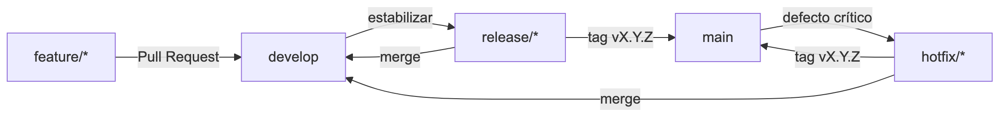

<strong><em>Nota.</em></strong> Elaboración propia a partir del modelo de ramas GitFlow descrito por Driessen (2010).

Las reglas de gestión de versiones y de mensajes son las siguientes. La Tabla 90 las resume con ejemplos del dominio de SafeFlow.

<strong>Tabla 90.</strong> <em>Reglas de ramas, versiones y mensajes de commit</em>

| Práctica | Regla | Ejemplo |
|:---|:---|:---|
| Ramas de funcionalidad | `feature/<bounded-context>-<descripcion>` en inglés, creadas desde `develop` | `feature/inventory-register-product` |
| Ramas de entrega | `release/<version>` creada desde `develop` | `release/0.1.0` |
| Ramas de corrección | `hotfix/<descripcion>` creada desde `main` | `hotfix/session-token-expiry` |
| Semantic Versioning | `MAJOR.MINOR.PATCH`: cambios incompatibles, funcionalidad nueva compatible, correcciones | `0.1.0` al cerrar el Sprint 1 |
| Conventional Commits | `<tipo>(<alcance>): <descripcion>` en imperativo e inglés; tipos `feat`, `fix`, `docs`, `test`, `refactor`, `chore` | `feat(inventory): register product with thermal range` |
| Commit de prueba | Tipo `test` con el contexto afectado | `test(iam): cover invalid credentials on sign in` |
| Integración | Pull Request hacia `develop` con al menos una revisión de otro integrante | Revisión de `feature/iam-sign-in` |

<strong><em>Nota.</em></strong> Elaboración propia. Los ejemplos son ilustrativos de la convención y no corresponden a commits ya realizados.

La combinación de las dos primeras prácticas de la Tabla 90 con los prefijos de alcance por Bounded Context permite rastrear cada cambio hasta la historia de usuario que lo originó.

### 4.1.3. Source Code Style Guide & Conventions

El código sigue las Kotlin coding conventions y la Android Kotlin style guide, y se organiza con la arquitectura vigente de la aplicación: un paquete por Bounded Context bajo `features/<contexto>/`, con las capas `domain`, `application`, `infrastructure` y `presentation`, además de `core/ui` para el sistema visual compartido. Las convenciones se aplican a todo el código del proyecto, y la revisión de Pull Requests verifica su cumplimiento. La Tabla 91 resume las reglas.

<strong>Tabla 91.</strong> <em>Convenciones de código y estructura</em>

| Ámbito | Convención |
|:---|:---|
| Idioma de los identificadores | Clases, funciones, variables y paquetes en inglés; términos del Ubiquitous Language mapeados 1:1 (por ejemplo, `ProductRegistered`, `StockEntryRegistered`) |
| Nombres de clases | `PascalCase`; casos de uso con verbo en imperativo (`RegisterProductUseCase`); ViewModels terminados en `ViewModel` |
| Funciones y propiedades | `camelCase`; constantes en `UPPER_SNAKE_CASE` |
| Paquetes | Minúsculas, uno por Bounded Context: `iam`, `inventory`, `monitoring`, `alerts`, `logistics`, `reporting` |
| Capas | `domain` sin dependencias de Android; `application` depende de contratos del dominio; `infrastructure` implementa repositorios y transforma DTO y entidades locales a modelos del dominio; `presentation` usa Compose, ViewModel y StateFlow |
| Aislamiento entre contextos | Ningún contexto importa repositorios, DTO ni ViewModels de otro |
| Interfaz | Composables reutilizables en `core/ui`; tokens de color, tipografía, radio y espaciado centralizados |
| Pruebas de aceptación | Escenarios en Gherkin (`Given`, `When`, `Then`) con los criterios de aceptación de cada historia |
| Formato | Indentación de 4 espacios, líneas de hasta 120 caracteres, sin código comentado |

<strong><em>Nota.</em></strong> Elaboración propia a partir de Kotlin Foundation (s. f.), Google (s. f.-a) y la arquitectura vigente de la aplicación.

Según la Tabla 91, la regla de mayor impacto es el aislamiento entre contextos, porque evita que los límites definidos en el diseño estratégico se erosionen durante la implementación.

### 4.1.4. Software Deployment Configuration

La aplicación Android se construye con Gradle y, durante el desarrollo, se genera como APK de depuración en `app/build/outputs/apk/debug/app-debug.apk` mediante la tarea `assembleDebug`. Para las sesiones de validación con usuarios, el equipo distribuirá las compilaciones a los dispositivos de prueba a través de Firebase App Distribution, de modo que cada participante instale la versión vigente sin necesidad de publicar la aplicación en una tienda. Antes de cada distribución se ejecutan `testDebugUnitTest` y `lintDebug`, y solo una compilación que pasa ambas tareas se publica a los evaluadores.

El servicio compartido, que recibe las mediciones simuladas de la aplicación emuladora y las sirve a la aplicación principal, se desplegará como servicio remoto accesible por HTTPS.

> Pendiente: plataforma, URL base y procedimiento de despliegue del servicio compartido.

### 4.1.5. Consideraciones éticas, i18n y accesibilidad

SafeFlow gestiona información operativa de empresas y datos de cuentas de usuario, por lo que el equipo adopta los principios del código de ética de ingeniería de software de ACM/IEEE y del Colegio de Ingenieros del Perú: veracidad en lo que se afirma del producto, respeto a la privacidad de los usuarios y responsabilidad por la calidad de lo entregado. Los términos y condiciones de servicio se muestran durante el registro de la cuenta, tal como lo contempla la historia US-30.

> Pendiente: texto de los términos y condiciones de servicio.

En internacionalización, la aplicación define como idiomas base el español latinoamericano (es_419) y el inglés (en_US), con los textos de interfaz en recursos de cadenas y no incrustados en el código. En accesibilidad, los componentes de `core/ui` exigen descripción de contenido (`contentDescription`) en íconos y botones de ícono, contraste suficiente en la paleta de colores semánticos y un objetivo táctil mínimo de 48 dp en los controles interactivos. Estas decisiones ya forman parte del sistema visual compartido, por lo que cada pantalla las hereda sin trabajo adicional.

## 4.2. Landing Page, Services & Applications Implementation

Esta sección registra la implementación de los productos de la solución por Sprint. Para la entrega TB1 el alcance es la aplicación Android principal; el Landing Page, el servicio compartido y la aplicación emuladora se abordan en entregas posteriores. Cada Sprint se presenta con su planificación, la matriz de responsabilidades, el Sprint Backlog y las evidencias de desarrollo, pruebas, ejecución, documentación de servicios, despliegue y colaboración.

### 4.2.1. Sprint 1

El Sprint 1 construye el primer incremento funcional de la aplicación: el acceso de los usuarios (registro, inicio de sesión y control por rol) y los datos maestros del inventario (productos con su rango térmico, lotes, ingresos de stock y consulta). Se eligieron estas historias porque son la base de las demás: sin identidad y sin productos no es posible monitorear, alertar ni despachar.

#### 4.2.1.1. Sprint Planning 1

El Sprint Planning 1 fija el objetivo del Sprint, las historias comprometidas y la capacidad del equipo. La Tabla 92 reúne el resumen de la reunión. Los datos de fecha, hora, lugar y asistentes se completarán con el acta real de la reunión.

<strong>Tabla 92.</strong> <em>Resumen del Sprint Planning 1</em>

| Campo | Valor |
|:---|:---|
| Sprint | Sprint 1 |
| Date | Pendiente |
| Time | Pendiente |
| Location | Pendiente |
| Prepared By | Pendiente |
| Attendees | Pendiente |
| Sprint 0 Review Summary | No aplica: es el primer Sprint del proyecto. La base técnica Android (estructura por Bounded Context, sistema visual y verificación de compilación) se preparó antes del Sprint. |
| Sprint 0 Retrospective Summary | No aplica: no existe Sprint anterior. |
| Sprint 1 Goal | Ver el Sprint Goal inmediatamente debajo de esta tabla. |
| Sprint 1 Velocity | 21 Story Points |
| Sum of Story Points | 21 Story Points |

<strong><em>Nota.</em></strong> Elaboración propia. Los campos marcados como Pendiente requieren el acta de la reunión; la velocidad es la capacidad que el equipo se compromete a aceptar y coincide con la suma de la Tabla 93.

> Pendiente: fecha, hora, lugar, responsable de preparación y asistentes del Sprint Planning 1.

El Sprint Goal se redactó con la plantilla de Scrum.org y con criterios SMART:

- **Our focus is on** que un usuario pueda registrarse, iniciar sesión y acceder solo a las funciones de su rol, y que el operador logístico pueda registrar productos con su rango de temperatura, lotes e ingresos de stock y consultar el inventario desde su celular.
- **We believe it delivers** a los operadores logísticos un control confiable de los productos sensibles a la temperatura desde el primer día de uso, y a los administradores una base de acceso que protege la información de la empresa.
- **This will be confirmed when** las siete historias del Sprint cumplen sus criterios de aceptación, un OPERADOR completa el flujo de registrar producto, lote e ingreso y lo ve reflejado en el inventario, y la compilación pasa `assembleDebug`, `testDebugUnitTest` y `lintDebug` sin errores al cierre del Sprint.

El objetivo es específico (siete historias nombradas), medible (criterios de aceptación y tareas de verificación), alcanzable (21 puntos), relevante (base de las demás entregas) y acotado en el tiempo (la duración del Sprint).

La Tabla 93 detalla las historias comprometidas y sus Story Points, según la estimación del backlog del producto.

<strong>Tabla 93.</strong> <em>Historias de usuario del Sprint 1</em>

| Id | Título | Bounded Context | Story Points |
|:---|:---|:---|:---:|
| US-31 | Iniciar sesión | IAM | 2 |
| US-18 | Controlar acceso por rol | IAM | 5 |
| US-30 | Registrarse en la aplicación | IAM | 3 |
| US-01 | Registrar producto | Inventory | 3 |
| US-19 | Registrar lote de producto | Inventory | 3 |
| US-02 | Registrar ingreso de stock | Inventory | 3 |
| US-10 | Consultar inventario | Inventory | 2 |
| **Total** | | | **21** |

<strong><em>Nota.</em></strong> Elaboración propia a partir del Product Backlog del Capítulo III.

#### 4.2.1.2. Aspect Leaders and Collaborators

La matriz Leadership-and-Collaboration Matrix (LACX) indica, para cada aspecto del Sprint, quién lidera y quiénes colaboran. Los aspectos del Sprint 1 siguen las capas de la arquitectura: Domain y Application, Infrastructure, Presentation (UI), Pruebas y Documentación. La Tabla 94 muestra una propuesta neutra que reparte el liderazgo entre los cuatro integrantes según los perfiles declarados en el Capítulo I.

<strong>Tabla 94.</strong> <em>Leadership-and-Collaboration Matrix del Sprint 1 (propuesta)</em>

| Team Member | GitHub Username | Domain y Application | Infrastructure | Presentation (UI) | Pruebas | Documentación |
|:---|:---|:---:|:---:|:---:|:---:|:---:|
| Acosta Elera, Abraam Bernabe | Pendiente | L | C | C | C | C |
| Bustinza Muñoz, Sebastian Alonso | Pendiente | C | C | L | C | C |
| Mio Mejia, Andy Alejandro | Pendiente | C | L | C | C | C |
| Morales Yapuchura, Jefferson Bayron | Pendiente | C | C | C | L | L |

<strong><em>Nota.</em></strong> Elaboración propia. L indica líder y C colaborador. La asignación es una propuesta basada en los perfiles del equipo.

> Pendiente: confirmar la asignación L/C con el equipo y completar los nombres de usuario de GitHub.

Como muestra la Tabla 94, todos colaboran en todos los aspectos y cada aspecto tiene un líder, lo que cumple con la regla del curso de que cada integrante participe en la implementación.

#### 4.2.1.3. Sprint Backlog 1

El Sprint Backlog 1 descompone cada historia del Sprint en tareas técnicas alineadas con las capas de la arquitectura. La Tabla 95 presenta las tareas con su estimación en horas, que es una propuesta inicial sujeta a ajuste en el Sprint Planning. La asignación y el estado se actualizarán a medida que avance el trabajo.

> Pendiente: captura del tablero del Sprint 1 y URL público del tablero.

<strong>Tabla 95.</strong> <em>Sprint Backlog 1: historias y tareas</em>

| US Id | US Título | Task Id | Task Título | Descripción | Estimación (h) | Assigned To | Status |
|:---|:---|:---|:---|:---|:---:|:---|:---|
| US-31 | Iniciar sesión | T-01 | Modelar sesión | Definir el modelo de sesión y el contrato del repositorio de sesión en `iam/domain` | 3 | Pendiente | To-do |
| US-31 | Iniciar sesión | T-02 | Caso de uso de inicio de sesión | Implementar `SignInUseCase` con manejo de credenciales inválidas | 4 | Pendiente | To-do |
| US-31 | Iniciar sesión | T-03 | Autenticación remota y sesión local | Implementar el adaptador Retrofit y el almacenamiento de sesión en DataStore | 6 | Pendiente | To-do |
| US-31 | Iniciar sesión | T-04 | Pantalla de inicio de sesión | Construir la pantalla Compose y su ViewModel con estados de carga y error | 6 | Pendiente | To-do |
| US-30 | Registrarse en la aplicación | T-05 | Modelar cuenta | Definir la cuenta de usuario y validaciones de correo y contraseña | 3 | Pendiente | To-do |
| US-30 | Registrarse en la aplicación | T-06 | Caso de uso de registro | Implementar `SignUpUseCase` con aceptación de términos y correo duplicado | 4 | Pendiente | To-do |
| US-30 | Registrarse en la aplicación | T-07 | Registro remoto | Implementar el adaptador de registro y la transformación de DTO a dominio | 4 | Pendiente | To-do |
| US-30 | Registrarse en la aplicación | T-08 | Pantalla de crear cuenta | Construir la pantalla Compose del mockup de crear cuenta con validación de campos | 6 | Pendiente | To-do |
| US-18 | Controlar acceso por rol | T-09 | Modelar roles y permisos | Definir los roles ADMIN, OPERADOR y SUPERVISOR y la política de permisos | 4 | Pendiente | To-do |
| US-18 | Controlar acceso por rol | T-10 | Autorización en casos de uso | Aplicar la verificación de permisos de la sesión en la capa de aplicación | 5 | Pendiente | To-do |
| US-18 | Controlar acceso por rol | T-11 | Navegación por rol | Mostrar solo las opciones permitidas y mensaje de acceso denegado en Compose | 6 | Pendiente | To-do |
| US-18 | Controlar acceso por rol | T-12 | Pantalla de permisos por rol | Construir la pantalla de permisos por rol para ADMIN según el mockup | 6 | Pendiente | To-do |
| US-01 | Registrar producto | T-13 | Modelar producto y rango térmico | Definir `Product` y `TemperatureRange` con reglas de validez | 4 | Pendiente | To-do |
| US-01 | Registrar producto | T-14 | Caso de uso de registro de producto | Implementar `RegisterProductUseCase` con campos obligatorios | 4 | Pendiente | To-do |
| US-01 | Registrar producto | T-15 | Persistencia de productos | Implementar entidad Room y repositorio de productos | 5 | Pendiente | To-do |
| US-01 | Registrar producto | T-16 | Formulario de producto | Construir la pantalla Compose de registrar producto | 6 | Pendiente | To-do |
| US-19 | Registrar lote de producto | T-17 | Modelar lote | Definir `Batch` vinculado al producto y regla de lote no vacío | 3 | Pendiente | To-do |
| US-19 | Registrar lote de producto | T-18 | Caso de uso de registro de lote | Implementar `RegisterBatchUseCase` con detección de lote duplicado | 4 | Pendiente | To-do |
| US-19 | Registrar lote de producto | T-19 | Persistencia de lotes | Implementar entidad Room y repositorio de lotes | 4 | Pendiente | To-do |
| US-19 | Registrar lote de producto | T-20 | Formulario de lote | Construir la pantalla Compose de registrar lote | 5 | Pendiente | To-do |
| US-02 | Registrar ingreso de stock | T-21 | Modelar ingreso de stock | Definir el ingreso y la regla de cantidad mayor que cero | 3 | Pendiente | To-do |
| US-02 | Registrar ingreso de stock | T-22 | Caso de uso de ingreso | Implementar `RegisterStockEntryUseCase` que actualiza el stock del producto | 4 | Pendiente | To-do |
| US-02 | Registrar ingreso de stock | T-23 | Persistencia de stock | Implementar actualización de stock en Room dentro de una transacción | 4 | Pendiente | To-do |
| US-02 | Registrar ingreso de stock | T-24 | Formulario de ingreso | Construir la pantalla Compose de registrar ingreso | 5 | Pendiente | To-do |
| US-10 | Consultar inventario | T-25 | Consulta de inventario | Implementar `GetInventoryUseCase` que entrega nombre, cantidad, estado y rango | 4 | Pendiente | To-do |
| US-10 | Consultar inventario | T-26 | Lista y estado vacío | Construir la pantalla Compose de inventario con estado vacío y acción de registro | 6 | Pendiente | To-do |
| US-10 | Consultar inventario | T-27 | Adaptación a tableta | Adaptar la lista del inventario a ancho de tableta con el sistema visual compartido | 4 | Pendiente | To-do |

<strong><em>Nota.</em></strong> Elaboración propia. Las estimaciones en horas son una propuesta; la asignación y el estado se actualizarán durante el Sprint.

La Tabla 95 contiene 27 tareas que cubren las cuatro capas en cada historia, de modo que ninguna historia queda con trabajo solo de interfaz o solo de dominio.

#### 4.2.1.4. Development Evidence for Sprint Review

Esta sección debe evidenciar, por repositorio, los commits relacionados con la implementación del Sprint 1. Estado actual: el proyecto Android contiene la base técnica sobre la que se implementarán las historias, es decir, la estructura de los seis Bounded Contexts por capas, el sistema visual compartido en `core/ui` y una compilación verificada con `assembleDebug`. Todavía no hay funcionalidades de negocio implementadas y el proyecto aún no está inicializado como repositorio Git, por lo que no existen commits que registrar. La Tabla 96 queda lista para completarse.

<strong>Tabla 96.</strong> <em>Commits de implementación del Sprint 1</em>

| Repository | Branch | Commit Id | Commit Message | Commit Message Body | Committed on (Date) |
|:---|:---|:---|:---|:---|:---|
| Pendiente | Pendiente | Pendiente | Pendiente | Pendiente | Pendiente |

<strong><em>Nota.</em></strong> Se completará con los commits reales una vez inicializados los repositorios.

> Pendiente: inicializar el repositorio Git de la aplicación Android y registrar los commits del Sprint 1.

#### 4.2.1.5. Testing Suite Evidence for Sprint Review

Esta sección presenta las pruebas automatizadas asociadas a las historias del Sprint: pruebas unitarias de los casos de uso y del dominio, y escenarios de aceptación en Gherkin derivados de los criterios de aceptación de cada historia. Estado actual: la tarea `testDebugUnitTest` se ejecuta correctamente sobre la base del proyecto, pero aún no existen pruebas de las historias porque no hay funcionalidades implementadas. La Tabla 97 registrará los commits de pruebas.

<strong>Tabla 97.</strong> <em>Commits de pruebas del Sprint 1</em>

| Repository | Branch | Commit Id | Commit Message | Commit Message Body | Committed on (Date) |
|:---|:---|:---|:---|:---|:---|
| Pendiente | Pendiente | Pendiente | Pendiente | Pendiente | Pendiente |

<strong><em>Nota.</em></strong> Se completará con los commits de tipo `test` y la relación entre pruebas y historias.

> Pendiente: relación de pruebas unitarias, archivos `.feature` en Gherkin con sus Steps y commits de pruebas.

#### 4.2.1.6. Execution Evidence for Sprint Review

Esta sección debe mostrar capturas de las vistas implementadas en el emulador o en un dispositivo, junto con un video que ilustre la navegación lograda en el Sprint. Hasta que existan las pantallas funcionales, el diseño de referencia de cada vista son los mockups del Capítulo III. La Tabla 98 organiza la evidencia por historia.

<strong>Tabla 98.</strong> <em>Evidencia de ejecución por historia del Sprint 1</em>

| Historia | Vista implementada | Captura | Estado |
|:---|:---|:---|:---|
| US-31 Iniciar sesión | Iniciar sesión | Pendiente | Por implementar |
| US-30 Registrarse en la aplicación | Crear cuenta | Pendiente | Por implementar |
| US-18 Controlar acceso por rol | Permisos por rol | Pendiente | Por implementar |
| US-01 Registrar producto | Registrar producto | Pendiente | Por implementar |
| US-19 Registrar lote de producto | Registrar lote | Pendiente | Por implementar |
| US-02 Registrar ingreso de stock | Registrar ingreso | Pendiente | Por implementar |
| US-10 Consultar inventario | Inventario | Pendiente | Por implementar |

<strong><em>Nota.</em></strong> Elaboración propia. Las capturas se agregarán cuando cada vista esté implementada.

> Pendiente: capturas de pantalla de las vistas implementadas y URL del video de la navegación del Sprint 1.

#### 4.2.1.7. Services Documentation Evidence for Sprint Review

Esta sección documenta los endpoints del servicio compartido que consume la aplicación en el Sprint 1 (autenticación y registro de cuentas, y datos de inventario cuando corresponda), en formato OpenAPI, con método, ruta, parámetros y respuestas. El servicio compartido aún no tiene contrato publicado, por lo que no se documentan endpoints en este informe.

> Pendiente: contrato OpenAPI del servicio compartido y relación de endpoints utilizados en el Sprint 1.

#### 4.2.1.8. Software Deployment Evidence for Sprint Review

Esta sección debe evidenciar los pasos del despliegue del Sprint 1: construcción del APK de depuración, ejecución de las verificaciones y distribución a los evaluadores. Estado actual: la compilación `assembleDebug` genera el APK en `app/build/outputs/apk/debug/app-debug.apk`, y las tareas `testDebugUnitTest` y `lintDebug` terminan sin errores sobre la base del proyecto. La distribución por Firebase App Distribution y la publicación del servicio compartido aún no se ejecutan.

> Pendiente: capturas de la compilación, de la distribución en Firebase App Distribution y del despliegue del servicio compartido.

#### 4.2.1.9. Team Collaboration Insights during Sprint 1

Esta sección presenta las analíticas de colaboración del repositorio (commits por integrante, líneas modificadas y Pull Requests) y la interpretación del equipo. Su objetivo es comprobar que los cuatro integrantes participan en la implementación. Como el repositorio Git aún no existe, no hay analíticas que mostrar.

> Pendiente: capturas de las analíticas de GitHub por integrante y redacción de su interpretación al cierre del Sprint 1.

### 4.2.2. Sprint 2

El Sprint 2 concentra el núcleo operativo (*core business*) de SafeFlow en la aplicación móvil principal y el despliegue al 100 % del servicio compartido en Microsoft Azure. En esta iteración se implementan los Bounded Contexts **Environmental Monitoring**, **Alerts** y **Logistics**: consulta de temperatura y disponibilidad del sensor, detección de desviaciones y productos en riesgo, historial térmico, recepción de alertas priorizadas por severidad, resolución mediante acciones correctivas, y registro, validación térmica previa y monitoreo de despachos en tránsito.

## 4.3. Validation Interviews

Las entrevistas de validación comprueban con usuarios reales de los segmentos objetivo (empresas del sector farmacéutico y operadores logísticos) que la aplicación resuelve sus tareas con claridad. En esta etapa el equipo definió el diseño de las entrevistas y la plantilla de evaluación; las sesiones se realizarán cuando existan flujos funcionales instalables.

### 4.3.1. Diseño de Entrevistas

Cada sesión se realiza con un usuario del segmento, con una compilación instalada mediante Firebase App Distribution, y se registra en video. El participante ejecuta tareas guiadas mientras el equipo observa y anota. La Tabla 99 define, por segmento, los elementos a validar y los flujos de usuario del Sprint 1.

<strong>Tabla 99.</strong> <em>Diseño de las sesiones de validación por segmento</em>

| Segmento | Elementos a validar | Flujos de usuario del Sprint 1 | Pregunta guía |
|:---|:---|:---|:---|
| Empresas del sector farmacéutico | Claridad del rango de temperatura del producto, trazabilidad por lote, control de acceso por rol | Inicio de sesión; registro de producto con rango térmico; registro de lote; consulta de inventario | ¿Se identifica con claridad qué productos y lotes están registrados y bajo qué condiciones deben conservarse? |
| Operadores logísticos | Rapidez del registro desde el celular, facilidad del ingreso de stock, lectura del inventario | Inicio de sesión; registro de ingreso de stock; consulta de inventario; registro de lote | ¿Puede registrar un ingreso y verificarlo en el inventario sin ayuda y con pocos pasos? |

<strong><em>Nota.</em></strong> Elaboración propia. El Landing Page se incorporará a las sesiones cuando esté disponible.

Como muestra la Tabla 99, ambos segmentos recorren el inicio de sesión y la consulta de inventario, lo que permite comparar la percepción de dos perfiles sobre las mismas pantallas.

### 4.3.2. Registro de Entrevistas

Para cada segmento se realizarán de 3 a 5 entrevistas. Cada registro incluirá nombres, apellidos, edad, distrito, una captura del video, el URL del video con el minuto de inicio y su duración, y un resumen de las apreciaciones del entrevistado sobre las tareas asignadas. La Tabla 100 queda preparada para completarse.

<strong>Tabla 100.</strong> <em>Registro de entrevistas de validación</em>

| Segmento | Nombres y apellidos | Edad | Distrito | Captura | URL del video, inicio y duración | Resumen |
|:---|:---|:---:|:---|:---|:---|:---|
| Pendiente | Pendiente | Pendiente | Pendiente | Pendiente | Pendiente | Pendiente |

<strong><em>Nota.</em></strong> Se agregará una fila por entrevista realizada.

> Pendiente: realizar las entrevistas (3 a 5 por segmento) y completar el registro con su evidencia en video.

### 4.3.3. Evaluaciones según heurísticas

La evaluación según heurísticas analiza lo observado en las sesiones desde la usabilidad, la arquitectura de información y el diseño inclusivo, con el formato del Anexo B. La siguiente ficha identifica la evaluación y las tareas que alcanza.

**Carrera:** Ingeniería de Software · **Curso:** 1ACC0238 Aplicaciones para Plataformas Móviles · **NRC:** Pendiente · **Profesores:** Todos · **Auditor:** Equipo de SafeFlow · **Cliente(s):** Pendiente (participantes de las sesiones)

**App a evaluar:** SafeFlow (aplicación Android)

**Tareas a evaluar:**

1. Registro de una cuenta nueva
2. Inicio de sesión
3. Registro de un producto con su rango de temperatura
4. Registro de un lote
5. Registro de un ingreso de stock
6. Consulta del inventario

**Tareas no incluidas en esta versión:** monitoreo térmico, alertas, despachos y reportes, previstos para Sprints posteriores.

Los problemas se puntúan con la escala de severidad de la Tabla 101.

<strong>Tabla 101.</strong> <em>Escala de severidad de los problemas de usabilidad</em>

| Nivel | Descripción |
|:---:|:---|
| 1 | Problema superficial: el usuario lo supera con facilidad y ocurre con muy poca frecuencia. Se corrige solo si hay tiempo disponible. |
| 2 | Problema menor: ocurre algo más seguido o es algo más difícil de superar. Prioridad baja para el siguiente release. |
| 3 | Problema mayor: ocurre con frecuencia o los usuarios no logran resolverlo. Debe corregirse con prioridad alta. |
| 4 | Problema muy grave: impide continuar con el uso de la herramienta. Debe corregirse antes del lanzamiento. |

<strong><em>Nota.</em></strong> Escala del formato de evaluación de User Experience según heurísticas del curso.

La Tabla 102 resume los problemas encontrados; se completará con una fila por problema tras las sesiones.

<strong>Tabla 102.</strong> <em>Tabla resumen de problemas detectados</em>

| # | Problema | Escala de severidad | Heurística o principio violado |
|:---:|:---|:---:|:---|
| Pendiente | Pendiente | Pendiente | Pendiente |

<strong><em>Nota.</em></strong> Las heurísticas se tomarán de las categorías Usability, Inclusive Design e Information Architecture.

> Pendiente: completar la tabla resumen y las descripciones de problemas (formato en el Anexo B) con las observaciones de las sesiones de validación.

#### 5.2.4.7. Software Deployment Evidence for Sprint Review

En esta sección se presenta el proceso de diseño de la infraestructura, el aprovisionamiento de los recursos en la nube y la configuración del flujo de despliegue continuo realizados durante este Sprint, evidenciando la puesta en producción de la aplicación.

### Introducción

Con el objetivo de contar con una infraestructura estable, segura y disponible para la ejecución de la plataforma, se implementaron dos servicios principales dentro del grupo de recursos `safeflow` en **Microsoft Azure**: un servidor administrado de **Azure Database for MySQL** y una **Web App** mediante **Azure App Services** para alojar la API desarrollada en .NET. Además, se integró el repositorio del proyecto con un proceso automatizado de **Integración y Despliegue Continuo (CI/CD)** para facilitar las actualizaciones de la aplicación.

#### **1. Implementación de la Base de Datos en Azure**

- Como primera etapa, se creó un servidor flexible de **Azure Database for MySQL**, seleccionando una configuración que permitiera optimizar la administración de costos, las tareas de mantenimiento y la disponibilidad del almacenamiento. Este procedimiento se muestra en el siguiente archivo.

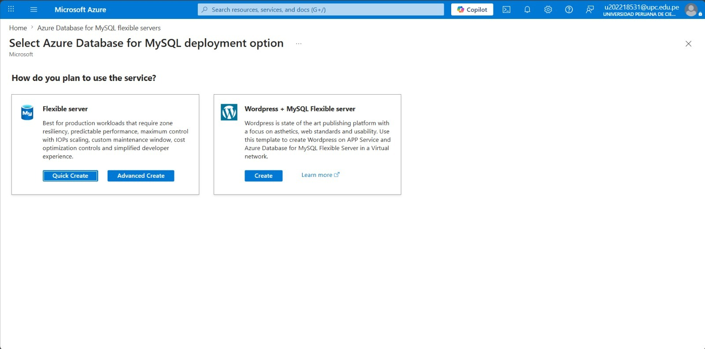

- Posteriormente, during la configuración inicial, se asignó la suscripción **Azure for Students** y se vinculó el servidor al grupo de recursos `safeflow`, asegurando que todos los servicios del proyecto permanecieran organizados dentro del mismo entorno. La configuración se aprecia en el siguiente archivo.

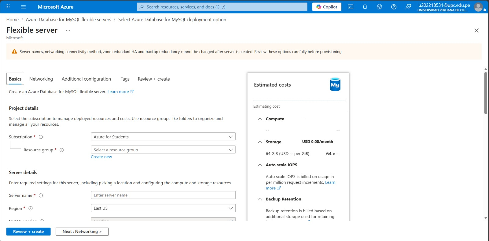

- Finalizada la creación del recurso, el servidor **safeflowdb** quedó operativo en la región **Southeast Asia**, utilizando el motor **MySQL 8.4** y el plan de cómputo **Burstable B1ms**, tal como se evidencia en la siguiente captura.

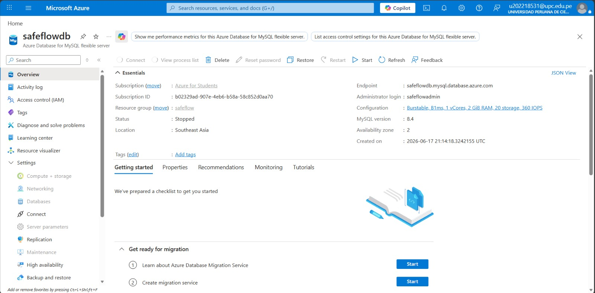

#### **2. Configuración de Seguridad y Base de Datos**

- Para permitir la conexión desde herramientas externas y facilitar la ejecución de migraciones, se configuró una regla de firewall denominada `MiComputadoraLocal`, autorizando el acceso desde la dirección IP pública del equipo de desarrollo. Este procedimiento se observa en la siguiente evidencia.

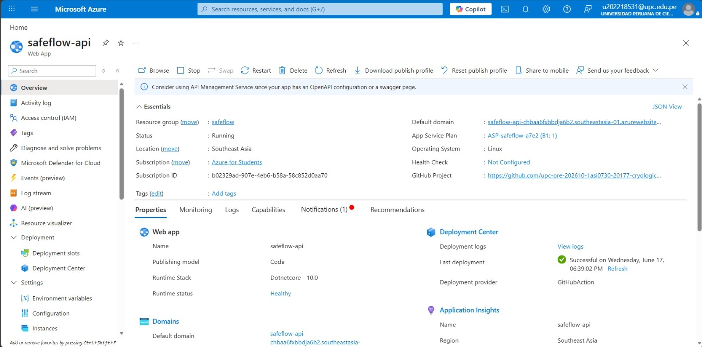

- Una vez habilitado el acceso al servidor, se creó el esquema relacional `safeflow_db`, el cual almacena la información utilizada por la aplicación en producción. La creación del esquema puede observarse en el siguiente archivo.

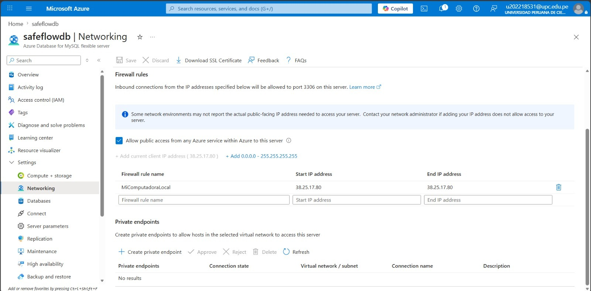

#### **3. Despliegue de la API mediante Azure App Services**

- Después de completar la configuración de la base de datos, se procedió con la creación de una **Web App** en **Azure App Services**, utilizando el mismo grupo de recursos para centralizar la administración de la infraestructura. La configuración inicial se muestra en el siguiente archivo.

- Durante la creación del servicio se definió una publicación basada en código, seleccionando la región **Canada Central**, el sistema operativo **Linux** y el plan de hospedaje **Basic B1**, configuración que se aprecia en la siguiente evidencia.

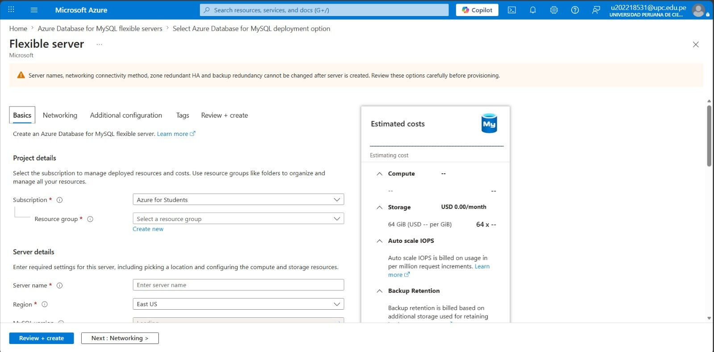

- Tras finalizar el aprovisionamiento, la aplicación **safeflow-api** quedó desplegada y en estado **Running**, confirmándose además la utilización del entorno **.NET 10.0** y la correcta conexión con el repositorio oficial del proyecto. Esta información puede observarse en el siguiente archivo.

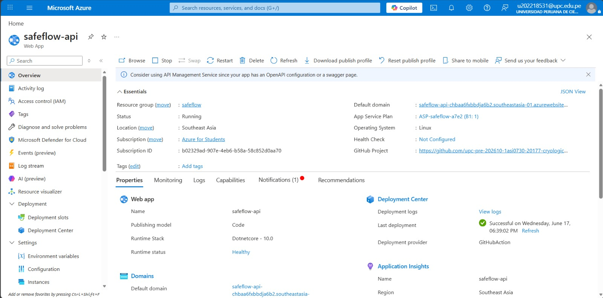

#### **4. Configuración de Variables y Automatización del Despliegue**

- Como parte de las buenas prácticas de seguridad, las credenciales de acceso a la base de datos fueron almacenadas mediante variables de entorno dentro de Azure. Para ello se configuró la cadena de conexión utilizando la clave `ConnectionStrings__DefaultConnection`, evitando incluir información sensible directamente en el código fuente. La configuración se muestra en la siguiente evidencia.

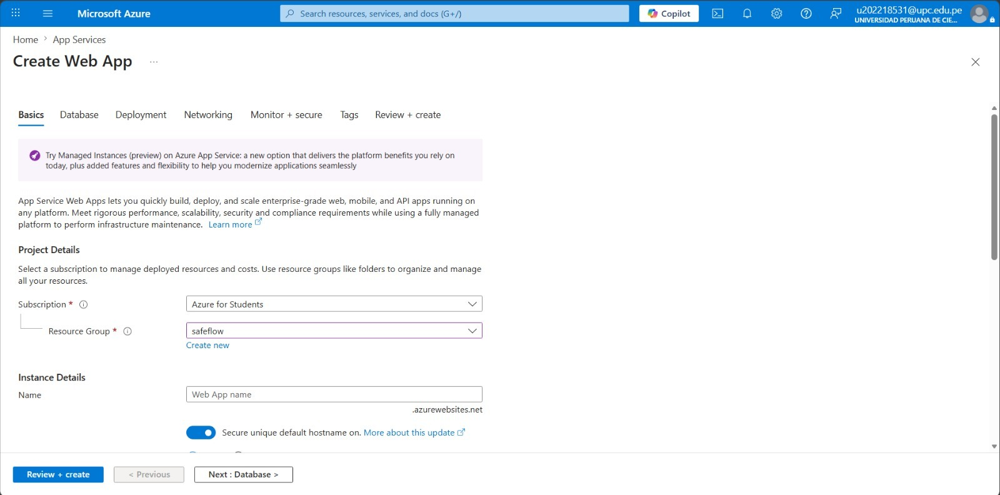

#### **5. Verificación de Endpoints y Consumo de Datos en Postman**

- Con el propósito de validar la correcta ejecución y disponibilidad de los servicios en el entorno de producción, se realizaron pruebas de integración utilizando Postman. Mediante peticiones HTTP directas hacia el servidor en la nube, se verificó la persistencia, el enrutamiento y la integridad de las respuestas del backend, confirmando la manipulación de datos en tiempo real de manera exitosa. La validación se detalla en el siguiente archivo.

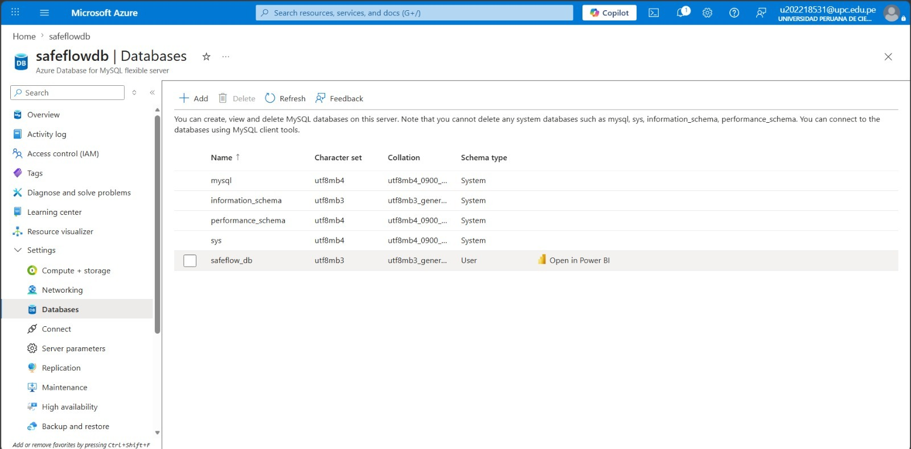

#### **6. Integración de Datos Reales y Funcionamiento End-to-End**

- Como etapa final del ciclo de despliegue, se validó la comunicación síncrona entre el frontend móvil y el backend alojado en Azure App Services. La interfaz de usuario procesa y visualiza de manera correcta los registros e información real almacenada en la base de datos, demostrando la operatividad completa, la consistencia de los datos y el correcto funcionamiento integrado de la aplicación. Esta evidencia se presenta a continuación.

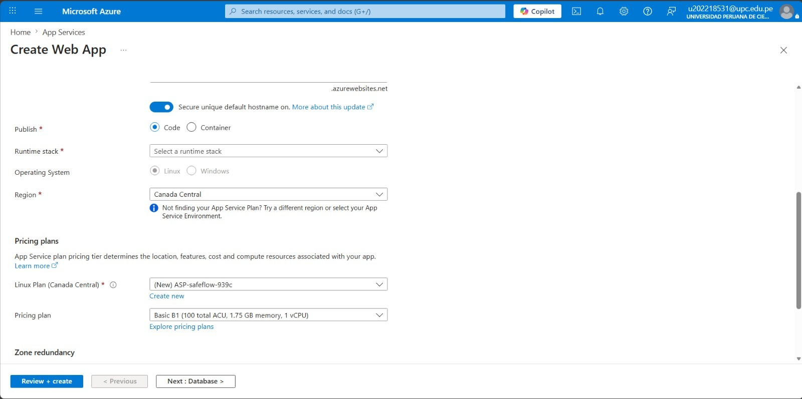

